# VyapaarFlow

**Retailer ordering and AI order capture for an FMCG distributor: kirana shops order on their phones, WhatsApp text orders become drafts the order desk checks, and confirmed orders go to Tally.**

| | |
|---|---|
| **Live application** | https://vyapaarflow-henna.vercel.app |
| **Repository** | https://github.com/KARTIKAY-SHUKLA1/vyapaarflow |
| **Technical Design Document** | [`docs/TDD.md`](docs/TDD.md) (exported as `Technical-Design-Document.pdf`) |
| **Deployment guide** | [`deployment.md`](deployment.md) |
| **Assignment** | Isocode Labs Software Engineering Internship take-home, Problem 5 ([brief](docs/BRIEF.md)) |
| **Author** | Kartikay Shukla, B.Tech Electronics and Communication Engineering, Indian Institute of Information Technology, Kota (IIIT Kota) |

> The live demo runs with **fictional data only** and in demo mode: anyone with the link can sign in as any demo user, including the order desk. Other reviewers may have changed the demo state.

---

## Contents

1. [The problem](#the-problem)
2. [What is built](#what-is-built)
3. [Screenshots](#screenshots)
4. [Try the demo](#try-the-demo)
5. [Technology stack](#technology-stack)
6. [Architecture](#architecture)
7. [AI order capture](#ai-order-capture)
8. [Human review and alias learning](#human-review-and-alias-learning)
9. [Pricing, schemes, GST and credit](#pricing-schemes-gst-and-credit)
10. [Order desk and Tally export](#order-desk-and-tally-export)
11. [Database](#database)
12. [Authentication, authorization and security](#authentication-authorization-and-security)
13. [Testing](#testing)
14. [Run it locally](#run-it-locally)
15. [Environment variables](#environment-variables)
16. [Deployment](#deployment)
17. [Assumptions, limitations and future work](#assumptions-limitations-and-future-work)
18. [AI-assisted development](#ai-assisted-development)

---

## The problem

A distributor in Jabalpur supplies 1,800 kirana shops with four packaged-food and home-care brands. Today salesmen write orders in notebooks, or shopkeepers send WhatsApp texts in their own words ("bhaiya 5 peti biscuit chhota…"). The next morning an office team of six retypes everything into Tally. Salesmen don't know stock or schemes at the counter, so lines are cut later and about 5% of orders need a return or redelivery. The brief estimates the cost at ₹52.5 lakh a year.

The client asked for a simple app where a retailer sees stock, their own price and the current scheme and orders in a minute, and where messages become orders the desk only has to check.

## What is built

The assignment's **core build** is implemented end to end: retailer catalogue with prices and schemes, cart and order, AI capture from a text order, and the order desk with Tally export, for two roles (retailer and order desk).

| Area | What works |
|---|---|
| **Sign-in** | Mobile number and OTP. SMS is mocked (an outbox table); in demo mode the code is shown on screen. Roles: retailer, order desk. |
| **Retailer catalogue** | Search, category filter, product pages, stock status (in stock / only N left / out of stock), the shop's price per case excluding GST, the scheme in force today, "your usual items" from past orders, available credit. |
| **Cart and checkout** | Server-priced cart with scheme progress ("Add 5 more for 1 free"), blockers explained per line, a final review, placing the order once even on a double tap, credit-hold warning. |
| **Retailer orders** | Order history with items and progress (Received → Approved → Billed), order detail, "Order again". |
| **AI order capture** | WhatsApp-style text (Hinglish, Hindi or English) is split into lines and matched to SKUs by a rules engine and, when configured, a language model (Google Gemini in the live deployment). Every line shows the retailer's words, a confidence level, up to two alternatives and any problems. |
| **Human review** | No order exists until a desk user resolves every line and ticks "I have checked every line". Unclear units (case or piece) block the order until the desk settles them. |
| **Alias learning** | A desk correction of the product, or a settled unit, is saved as that shop's alias for those words and used in the shop's next capture. |
| **Order desk** | Attention summary, order queue with filters and search, approve, release a credit hold with a reason, cancel with a reason (returns stock), audit history, shops with no order in 14 days. |
| **Tally export** | Approved orders exported once to a Tally-style CSV (UTF-8 with BOM), money checked before anything changes; past exports can be downloaded again. |
| **Languages** | Full English and Hindi interface on the sign-in, retailer and desk screens; Hindi product names. |
| **Public landing page** | An English product overview at `/` for signed-out visitors, with real screenshots and links to sign in. Signed-in users skip it and go to their home. It does not have a Hindi version. |

**Not built** (optional depth in the brief): photo or voice-note capture, the salesman app and offline mode, van loading lists, a service worker. See [limitations](#assumptions-limitations-and-future-work).

## Screenshots

Captured from a local production build with the seed data (the live site was not used, so no production records were written). In these screenshots AI capture runs with the provider turned off, so the review screen shows the labelled rule-based result; with a model configured, the same screen shows the model's proposals after validation.

**Retailer (phone, 390 px)**

| Sign-in with demo OTP | Catalogue | Product | Cart |
|---|---|---|---|
| 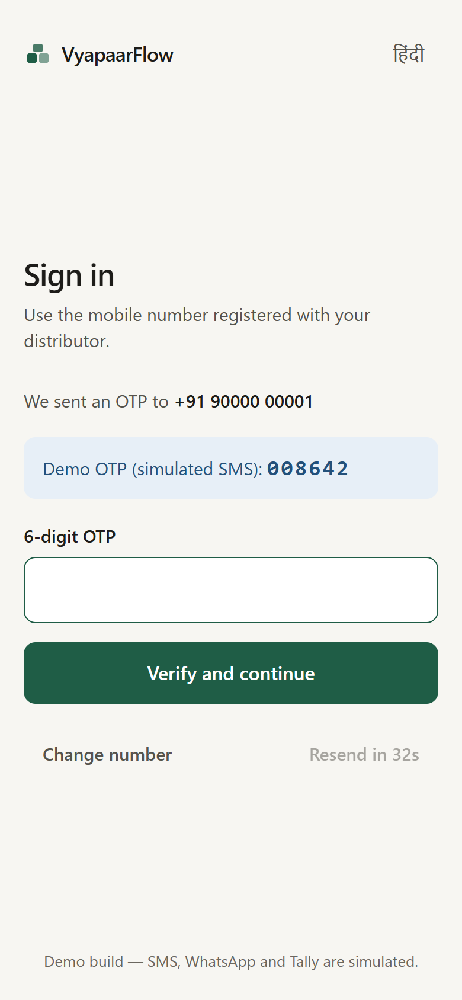 | 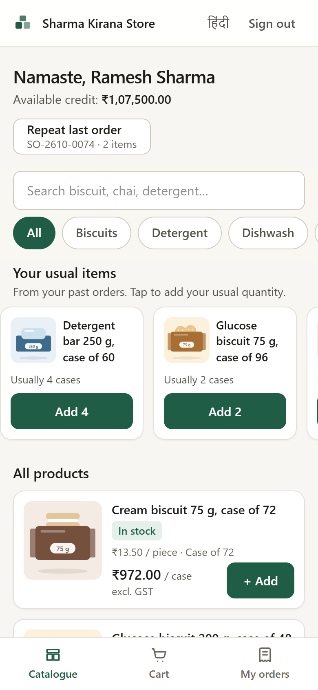 | 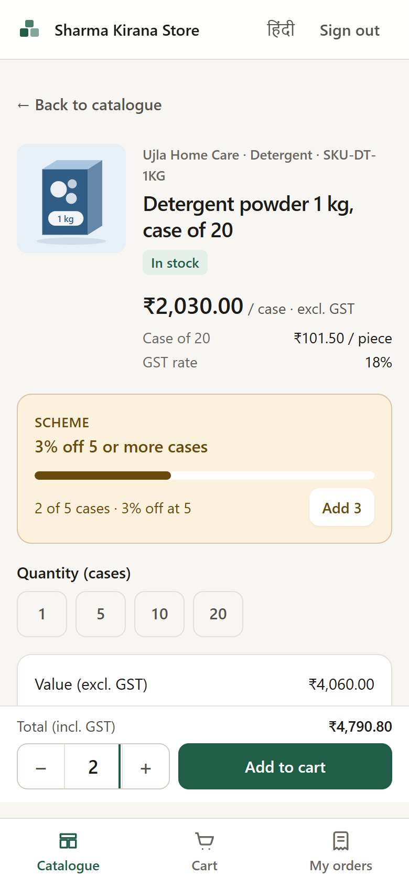 | 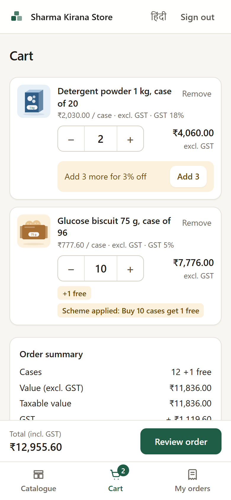 |

| Checkout | Order placed | Order history | Hindi |
|---|---|---|---|
| 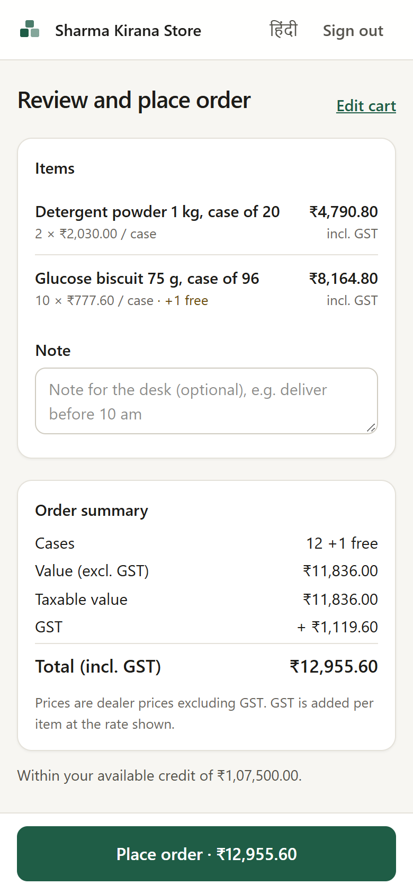 | 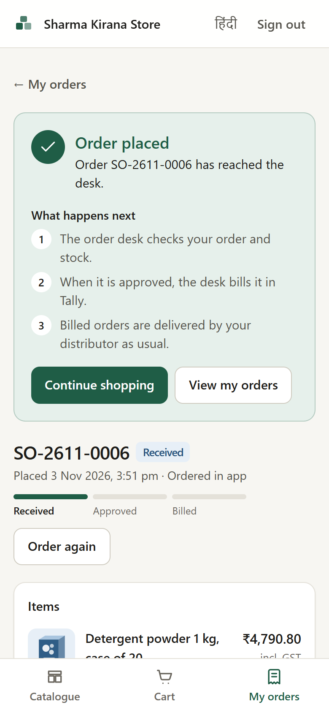 | 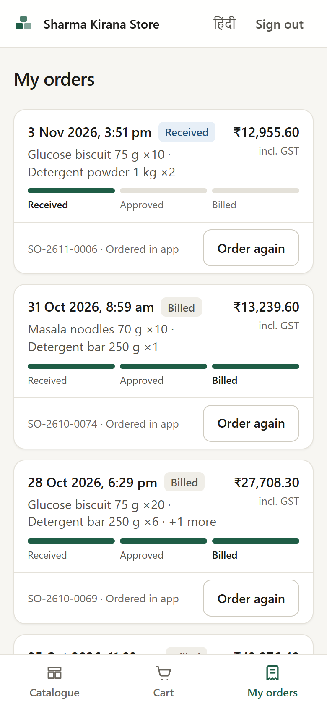 | 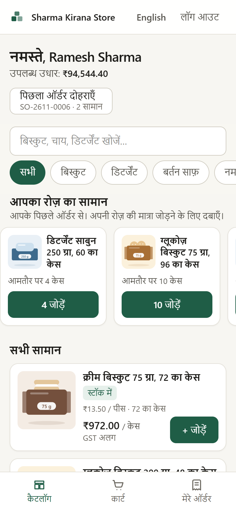 |

**Order desk (desktop, 1280 px)**

| Dashboard | AI inbox |
|---|---|
| 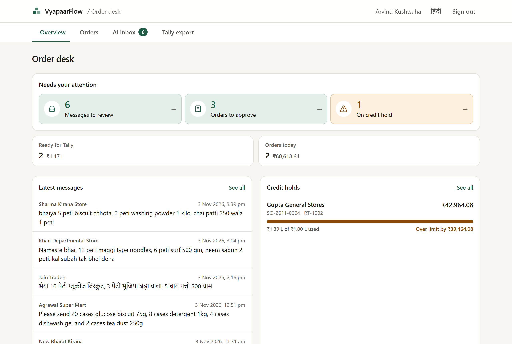 | 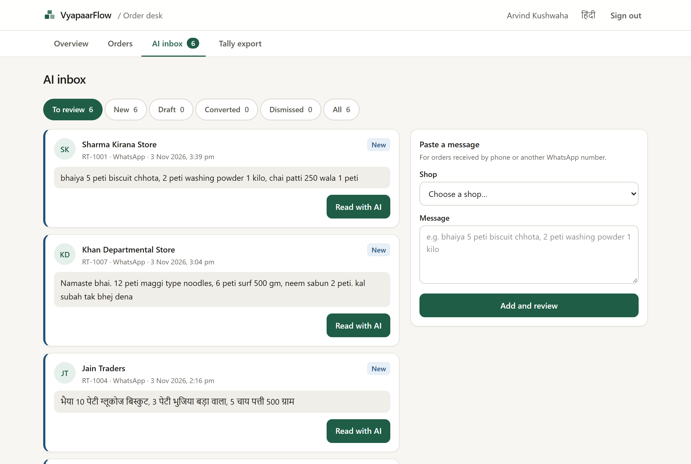 |

| AI review | Order approval |
|---|---|
| 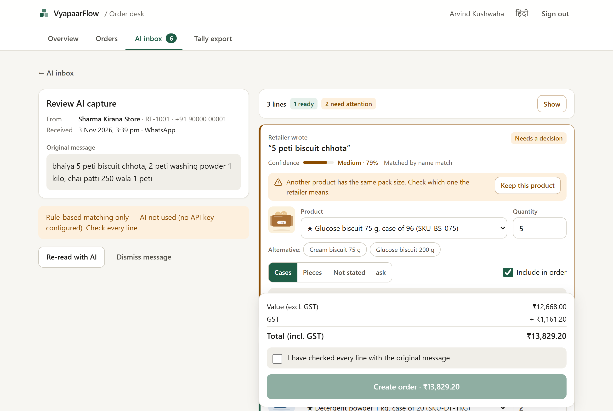 | 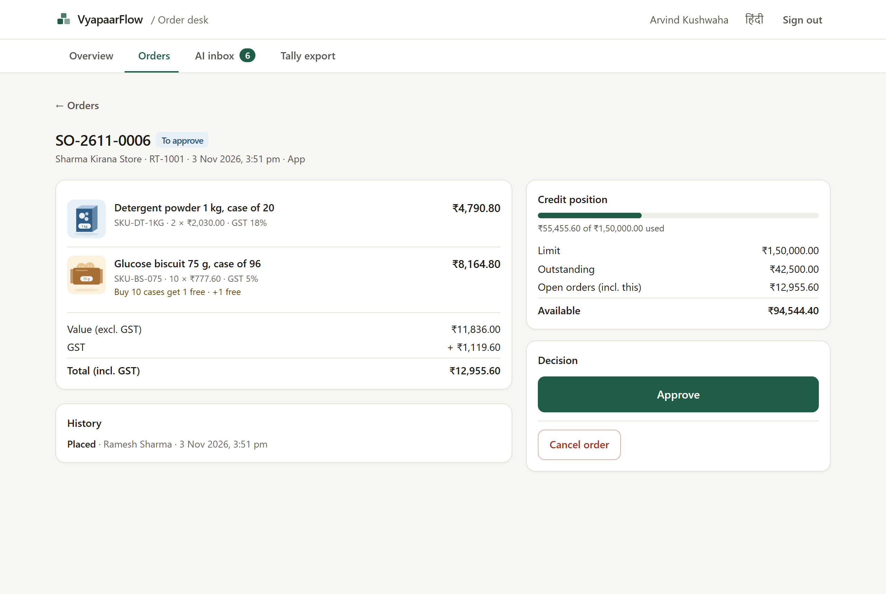 |

| Credit hold | Tally export |
|---|---|
| 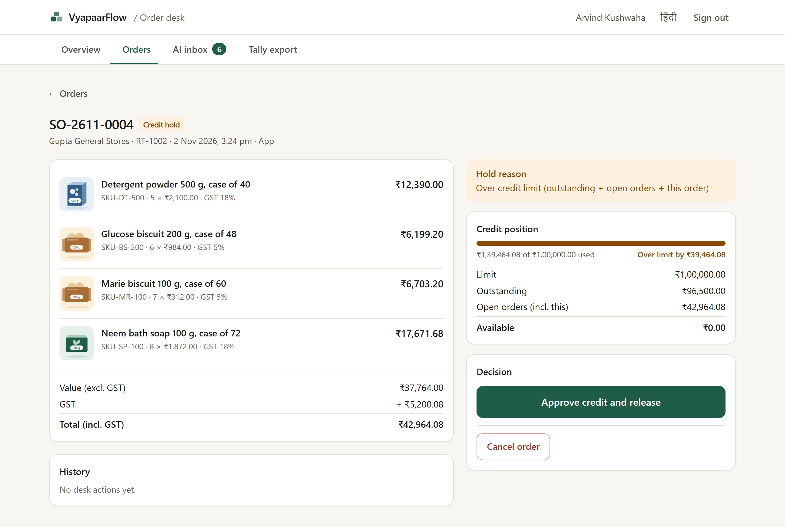 | 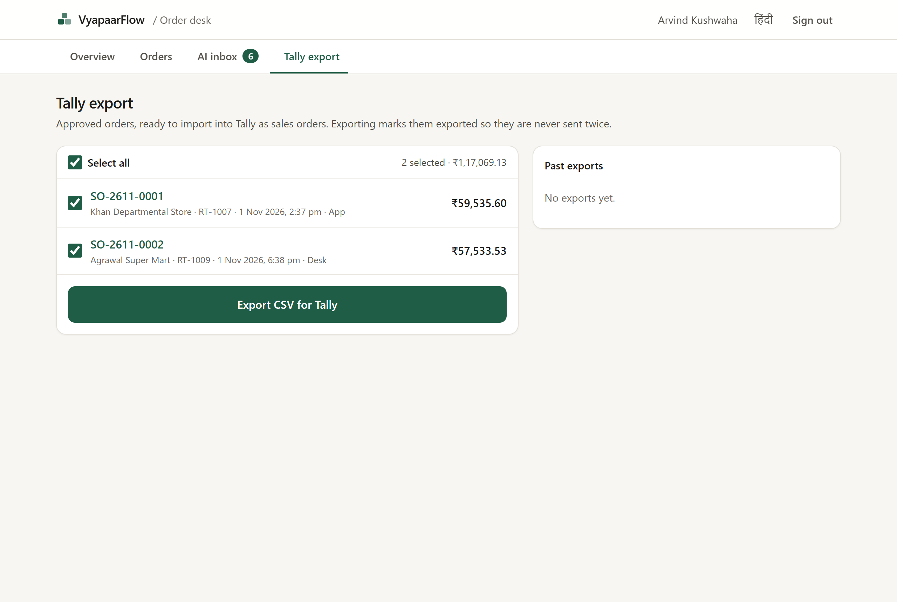 |

More in [`docs/screenshots/`](docs/screenshots/).

## Try the demo

Open https://vyapaarflow-henna.vercel.app. Signed-out visitors see the public landing page; choose **Explore Demo** or **Sign In** to reach the sign-in screen (`/login`). Enter one of the numbers below and press **Send OTP**. Demo mode shows the six-digit code on the screen (the simulated SMS); enter it and continue.

| Role | Mobile | What to try |
|---|---|---|
| Retailer, Sharma Kirana Store | 90000 00001 | Catalogue, schemes, cart, place an order |
| Retailer near the credit limit, Gupta General Stores | 90000 00002 | An order that goes to credit hold |
| Order desk, Neha Soni | 90000 00100 | AI inbox → review → create order → approve → Tally export |
| Order desk, Arvind Kushwaha | 90000 00101 | Same as above |

All shops, people and numbers are fictional (the 12 seeded shops use 90000 00001 to 90000 00012). OTP rules still apply in demo mode: a code expires after 5 minutes, allows 5 attempts, and a new code can be requested after 30 seconds.

## Technology stack

| Layer | Choice | Why |
|---|---|---|
| Framework | **Next.js 16** (App Router, React Server Components, server actions), **React 19**, **TypeScript** | One codebase for UI and server; server components keep prices and credit on the server and send little JavaScript to low-end phones; server actions give typed mutations without a separate API layer. |
| Database | **SQLite** locally, **Turso** (libSQL) in production, **Drizzle ORM** with versioned SQL migrations | Same SQL dialect in development, tests and production; real transactions for stock reservation and exports; Turso's free tier fits the demo. |
| Validation | **Zod** | Every server action and every model response is parsed before use. |
| Sessions | **jose** (HS256 JWT in an httpOnly cookie) | Small, standards-based; the role is re-checked against the database on every request. |
| Styling | **Tailwind CSS 4** | Design tokens in one place, no runtime CSS-in-JS. |
| AI | Provider interface with **Google Gemini** (`generateContent` over `fetch`), **Anthropic** (official SDK) and any **OpenAI-compatible** endpoint | The distributor can choose an affordable model; the app never depends on one vendor. |
| Tests | **Vitest** (unit and integration on real SQLite files), **puppeteer-core** (browser end-to-end) | Fast logic tests plus real-browser checks of the main flows. |
| Hosting | **Vercel** (functions in Singapore, `sin1`) + **Turso** (AWS Singapore) | Functions sit next to the database; free tiers suffice. |

## Architecture

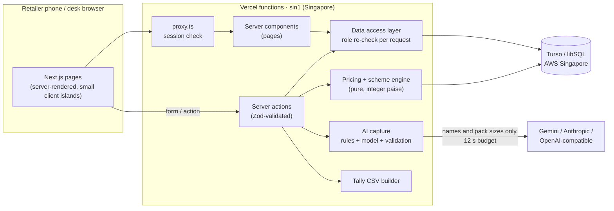

- **Server is the source of truth.** The client sends only SKU ids and case counts; prices, schemes, GST, stock and credit are recalculated on the server for every cart view and again when the order is written.
- **Three layers of access control.** `src/proxy.ts` redirects visitors without a valid session; every page and server action calls the data access layer (`src/lib/auth/dal.ts`), which re-reads the user's role and active flag from the database; every service function checks the role again.
- **Pure core logic.** The pricing engine (`src/lib/pricing`), the capture matcher (`src/lib/capture`) and the Tally builder (`src/lib/tally`) have no I/O, which is why they carry most of the tests.

Route map:

| Retailer (`/shop`) | Order desk (`/desk`) |
|---|---|
| `/shop` catalogue · `/shop/p/[code]` product · `/shop/cart` · `/shop/checkout` · `/shop/orders` · `/shop/orders/[id]` | `/desk` overview · `/desk/orders` · `/desk/orders/[id]` · `/desk/inbox` · `/desk/inbox/[id]` review · `/desk/export` · `/desk/export/[id]` CSV download |

`/` is public: signed-out visitors see the English landing page, signed-in retailers are redirected to `/shop` and order-desk users to `/desk`. `/login` is the sign-in page.

## AI order capture

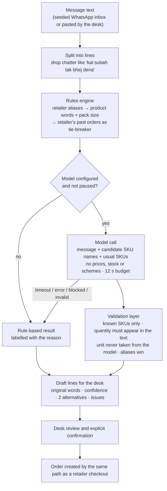

- **The model only proposes.** It sees the message, a short list of candidate SKU codes and names per line, and the shop's usual SKUs. It never sees or sets prices, stock or schemes, and the prompt treats the message as data, not instructions.
- **Validation (`src/lib/capture/validate.ts`).** Model output is parsed with Zod (unknown keys such as a price are dropped). A SKU must be one that was offered; a quantity must be a number the retailer actually wrote; the unit always comes from the retailer's words (peti / case / carton / box → case, piece / pcs / packet → piece, otherwise unknown); a saved alias overrides the model; when the model and the rules disagree, confidence is capped so the desk looks.
- **Fallback.** With no provider, or when the model times out, fails, is blocked or returns invalid output, the rule-based result is used and the screen says why (for example "AI did not answer within 12 seconds"). Gemini gets one bounded retry for HTTP 429/503 inside the same 12-second budget. After two availability failures within five minutes, automatic AI calls pause for two minutes; "Re-read with AI" bypasses the pause.
- **Diagnostics.** Each capture records the engine, model, fallback reason, attempts and latency in the audit log (never the API key or the message sent to the provider).

## Human review and alias learning

The review screen (`/desk/inbox/[id]`) shows the original message beside one card per captured line: the retailer's words, the chosen product (with full name on phones), quantity, unit choice (Cases / Pieces / Not stated — ask), confidence, how it was matched, two alternatives, live server price and any warning. A summary counts lines that are ready, need a decision or are excluded.

- **Nothing is ordered automatically.** The server requires a decision for every line, at least one included line, the explicit "I have checked every line with the original message" confirmation, and the total the desk saw (if prices changed meanwhile, it refuses and shows the new prices).
- **Unclear units are held, not guessed.** Orders are in cases. A line in pieces or with no unit cannot become an order until the desk agrees the case quantity with the retailer — the desk does this outside the app; the app does not message the retailer.
- **Corrections are learned per shop.** When the desk changes the product, or settles the unit, those words become that shop's alias (`retailer_aliases`). The next capture for the same shop uses it first. Changed quantities are not learned, because they vary from order to order.
- Unknown senders must be linked to a shop before any order can exist; a message can be dismissed with a reason.

## Pricing, schemes, GST and credit

All money is stored as **integer paise** and all rates as **basis points**, so there is no floating-point money anywhere. The engine (`src/lib/pricing/engine.ts`) is pure and has the largest test suite.

- **Price:** the sample "dealer price" is read as per piece excluding GST (₹8.10 for a biscuit packet), so a case costs pack size × piece price (96 × ₹8.10 = ₹777.60). Each SKU can have a price per price tier; a retailer only ever sees their tier's price.
- **Schemes:** free goods ("buy 10 cases get 1 free") repeat per full multiple and are capped by available stock (the line is flagged if short); slab discounts ("3% off 5 or more cases") apply to the whole line once the threshold is met. At most one scheme applies per SKU; schemes have validity dates. The cart shows how far the retailer is from the next benefit.
- **GST:** discount first, then GST per line on the taxable value. Rates are configurable per SKU; the seeded rates (5% food, 18% home care) are placeholders, not tax advice. Every price says whether it is excluding or including GST; free cases carry no value and no GST in this model (assumption to be confirmed by the client's accountant).
- **Credit:** exposure = outstanding (seeded) + open orders (placed, on hold, approved). An order that would exceed the limit is **placed on credit hold** for the desk, never rejected and never auto-released. The check runs again inside the order's database transaction so two simultaneous orders cannot both slip under the limit.
- **Stock:** reserved when the order is created (paid and free cases), with a conditional update so stock can't go negative; returned if the desk cancels.

Worked example, the brief's message for Sharma Kirana Store: 5 cases glucose biscuit = ₹3,888.00 + 5% GST = **₹4,082.40** (5 short of a free case); 2 cases detergent = ₹4,060.00 + 18% GST = **₹4,790.80** (3 short of 3% off); tea 250 g is out of stock and is flagged, not accepted. Total **₹8,873.20** incl. GST — the same figures the cart test checks.

## Order desk and Tally export

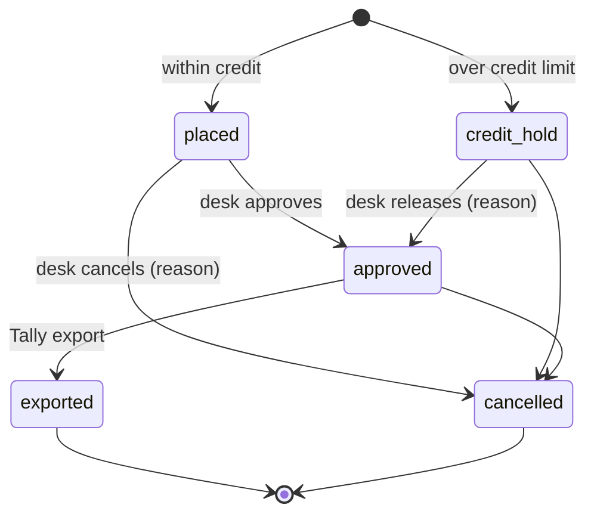

- Status changes are conditional on the current status, so two desk users can't both act on one order; every change is written to the audit log, with the reason for releases and cancellations. Cancelling returns reserved stock in the same transaction.
- **Tally export** (`/desk/export`): pick approved orders and export. The CSV is built and its money checked before anything changes; then the orders move from approved to exported in one transaction, conditional on still being approved, so **an order can never be exported twice**, even by two desk users at once. The file is UTF-8 with BOM and CRLF line endings, one row per order line (Sales Order voucher, party code and ledger, item, billed and free quantity, case rate, gross, discount, taxable, GST %, GST, line and order totals, scheme, source, narration), with text cells protected against spreadsheet formula injection. The column layout is an assumption: no client import template was supplied.

## Database

18 tables, defined in [`src/db/schema.ts`](src/db/schema.ts) with four versioned migrations in [`drizzle/`](drizzle/) (`0003_rate_limits` adds the OTP rate-limit counters).

| Group | Tables |
|---|---|
| People and shops | `users` (role: retailer, desk or salesman), `retailers` (credit limit, outstanding, price tier, salesman) |
| Catalogue | `brands`, `skus` (pack size, GST rate, Hindi name), `prices` (per SKU and price tier), `stock`, `schemes` |
| Orders | `orders` (totals, status, idempotency key, hold/cancel reasons), `order_lines` (prices and scheme as applied) |
| Capture | `inbound_messages`, `captures` (engine, model, fallback reason), `capture_lines` (original words, confidence, alternatives, desk decisions), `retailer_aliases` |
| Platform | `otp_codes` (hashed), `sms_outbox` (mocked SMS), `audit_log`, `tally_exports` |

Seed data (`src/db/seed-data.ts`, all fictional): the brief's three SKUs exactly as given plus 17 more across 4 brands, 6 schemes (including one expired and one future scheme), 12 shops in Jabalpur areas, 2 desk users, 2 salesmen, 6 WhatsApp messages including the brief's raw message, and 148 historical orders (548 lines) so "usual items", alias tie-breaks and the 14-day dashboard have data.

## Authentication, authorization and security

- **OTP:** six-digit codes stored as HMAC-SHA256 hashes, compared in constant time, valid 5 minutes, 5 attempts, single use, 30 seconds between sends and 5 per hour per number. Unknown numbers get the same response as registered ones.
- **Sessions:** HS256 JWT in an `httpOnly`, `SameSite=Lax` cookie (`Secure` in production), 7 days. There is no default secret: the app refuses to run without a `SESSION_SECRET` of at least 32 characters.
- **Authorization:** retailer pages show only the signed-in shop's data; the shop id always comes from the session, never from the request. Another shop's order returns a real 404 that reveals nothing. Desk functions check the desk role themselves. The access rule for a shop's prices and credit (shop, its salesman, the desk) is implemented and tested; salesmen cannot sign in yet.
- **Data integrity:** stock reservation and credit checks inside write transactions, idempotency keys against double orders, conditional status updates, money totals cross-checked before Tally export.
- **Input and output:** Zod on every server action and model response; security headers (`X-Frame-Options: DENY`, `nosniff`, referrer and permissions policies); the CSV download is desk-only and never cached.
- **Configuration safety:** in production the server refuses to start without a remote Turso URL and token; `db:seed` and `db:reset` refuse to wipe a remote database without an explicit opt-in. No secrets are in the repository (`.env*` is git-ignored); tests block real network calls.

## Testing

| Command | What it runs |
|---|---|
| `npm test` | Vitest unit and integration tests. Database tests get a fresh, migrated and seeded SQLite database in a temporary file (not in memory), so concurrent writes behave like a real database. Real network calls are blocked. |
| `npm run e2e` | Run `npm run build` first. Resets its own `data/e2e.db`, starts the production build on port 3100 and drives a locally installed Chrome or Edge through the landing, retailer, desk and security suites. |
| `npm run e2e:landing` | Run `npm run build` first. The public landing page suite only, at 1280 px and 390 px. Any suites can be picked with `npm run e2e -- landing,security`. |
| `npm run typecheck` · `npm run lint` · `npm run build` | Type generation + TypeScript, ESLint, production build. |
| `npm run check` | Typecheck + lint + unit tests. |

**Latest verified run** (3 November 2026, on deployed commit `e3e92f8` plus the CSS inlining change in `next.config.ts`):

| Check | Result |
|---|---|
| Unit and integration tests | **607 passed** in 28 files |
| End-to-end checks | **149 passed** in 4 suites (landing 49, retailer 34, desk 48, security 18) |
| Typecheck, lint, production build | Passed |

What the tests cover: the pricing and scheme engine (46 tests: tiers, free goods, slabs, validity dates, stock caps, GST rounding); order placement (server totals, stock reservation, duplicate submits, two shops racing for stock, simultaneous orders against the credit limit); capture parsing, matching, aliases and the validation layer; the Gemini adapter, retries and circuit breaker (all with mocked HTTP); confirmation rules (explicit tick, every line decided, units settled, model prices ignored); Tally CSV format and money checks; OTP, sessions and access rules; database and wipe-guard configuration. End-to-end checks cover the public landing page at 1280 px and 390 px (title, description and headline; images and horizontal overflow; nav links, the mobile menu and the preview tabs by click and keyboard; the skip link and the favicon; every Explore Demo and Sign In link going to `/login`; console errors and failed requests; and signed-in retailers and desk users at `/` or `/login` being sent to `/shop` or `/desk`), the retailer flow in English and Hindi, the desk flow from WhatsApp message to Tally CSV, and access control (signed-out users, retailers on desk pages, another shop's order, forged cookies).

## Run it locally

Requires Node.js 20.9 or later.

```bash
git clone https://github.com/KARTIKAY-SHUKLA1/vyapaarflow.git
cd vyapaarflow
npm ci
cp .env.example .env.local      # then set SESSION_SECRET (the file shows a one-line generator)
npm run db:reset                # create data/local.db, migrate and seed the fictional data
npm run dev                     # http://localhost:3000
```

Without an AI key, capture uses the rule-based matcher and says so. Full instructions, Turso and Vercel setup and troubleshooting: [`deployment.md`](deployment.md).

## Environment variables

Names only; see [`.env.example`](.env.example) and [`deployment.md`](deployment.md#10-environment-variables) for what each one does.

| Required | Optional |
|---|---|
| `SESSION_SECRET`, `DATABASE_URL`, `DATABASE_AUTH_TOKEN` (production) | `DEMO_MODE`, `AI_PROVIDER`, `GEMINI_API_KEY`, `GEMINI_MODEL`, `GEMINI_THINKING_LEVEL`, `ANTHROPIC_API_KEY`, `ANTHROPIC_MODEL`, `AI_BASE_URL`, `AI_MODEL`, `AI_API_KEY`, `AI_JSON_MODE`, `ALLOW_LOCAL_DATABASE`, `ALLOW_REMOTE_WIPE` |

## Deployment

The live app runs on **Vercel** with functions in **Singapore (`sin1`)** next to a **Turso** database in AWS Singapore. The region is set in the Vercel dashboard (there is no `vercel.json`). The database was migrated and seeded once from a developer machine; Vercel builds with `next build` and holds the environment variables. Step-by-step instructions: [`deployment.md`](deployment.md).

## Assumptions, limitations and future work

The brief leaves several business rules open; each assumption is labelled (A1–A15) and explained in the [TDD](docs/TDD.md#19-assumptions-and-their-rationale). The main ones: dealer price is per piece excluding GST; orders are in cases; free goods repeat per multiple and need stock; slab discounts apply to the whole line; GST rates are placeholders; credit exposure includes open orders; the Tally column layout must be confirmed against the client's template.

**Not implemented**

- AI capture from a photo of a list, or from a Hindi voice note (text only).
- Salesman sign-in, the salesman app and offline ordering; no service worker or offline caching (the app has a web manifest and icons only).
- Van loading lists.
- Real SMS and WhatsApp integration (both mocked), and synchronisation with Tally (outstanding balances are seeded and do not change when orders are invoiced).

**Known limitations**

- All seeded shops use the same `standard` price tier, so the demo shows one price list even though per-tier prices are supported.
- AI accuracy has not been formally benchmarked; Gemini free-tier latency and availability vary, which is why every capture has a 12-second budget and a labelled fallback. Free-tier model providers may use submitted content, so only fictional data should be sent.
- First load on slow 3G has not been formally measured.
- Unclear units are held for the desk to clarify with the retailer; the app does not send clarification questions.
- Exported orders no longer count towards credit exposure, because there is no Tally sync to raise the outstanding balance.
- Demo mode lets anyone sign in as any user; demo data is fictional and changes as reviewers use it. The seeded brief schemes are valid until 31 December 2026.
- Smaller items: no Content-Security-Policy header; sessions can't be revoked before they expire; OTP limits are per number, not per IP; hold reasons are stored in English; the desk queue shows the latest 100 orders; the AI pause state is per server instance.

**Future work:** photo and voice capture through the same validation layer; salesman mode with offline ordering; van loading lists; WhatsApp Business and SMS integration; Tally sync and a confirmed import template; per-shop price tiers in the seed; a performance pass (parallel queries, fewer round trips) and a measured slow-3G target.

## AI-assisted development

AI coding assistants (Anthropic's Claude) were used during development for code generation, debugging, test writing and drafting documentation; commits made with that help carry a `Co-Authored-By` trailer. The developer made the product and design decisions, defined the assumptions, reviewed the code, ran and checked the tests, tested the deployed application by hand and verified the final documentation.
