

# VyapaarFlow

## Technical Design Document

Retailer ordering app with AI order capture for an FMCG distributor

| | |
|---|---|
| **GitHub repository** | **https://github.com/KARTIKAY-SHUKLA1/vyapaarflow** |
| **Live application** | https://vyapaarflow-henna.vercel.app |
| **Assignment** | Isocode Labs, Software Engineering Internship take-home, Problem 5 |
| **Author** | Kartikay Shukla |
| **College** | Indian Institute of Information Technology, Kota (IIIT Kota) |
| **Programme** | B.Tech, Electronics and Communication Engineering |
| **Version** | 1.1, 3 November 2026 (deployed code at commit `e3e92f8`) |
| **Submission deadline** | 9 November 2026 |

## Contents

1. Executive summary
2. Problem statement and objectives
3. Scope and implemented features (with assignment compliance summary)
4. Functional and non-functional requirements
5. Architecture and technology choices
6. System architecture
7. Database design
8. Authentication and authorization
9. Retailer ordering workflow
10. Pricing, schemes, GST and credit
11. AI capture architecture and data flow
12. Human-in-the-loop review and alias learning
13. Order desk workflow
14. Tally CSV export
15. UI/UX and low-network design
16. Security and data integrity
17. Testing strategy and verified results
18. Deployment architecture
19. Assumptions and their rationale
20. Known limitations and failure handling
21. Future improvements
22. Conclusion

Appendix A: AI-assisted development · Appendix B: screenshots

## 1. Executive summary

VyapaarFlow is a web application for a packaged-goods distributor in Jabalpur that serves 1,800 kirana shops. It replaces two manual paths: shopkeepers sending orders on WhatsApp in their own words, and an office team retyping those orders into Tally the next morning.

The application delivers the assignment's core build end to end:

- **Retailers** sign in with their mobile number and an OTP, browse a catalogue with their own price, the stock status and the scheme in force today, build a cart that the server prices exactly (including free goods, slab discounts, GST and credit), and place an order.
- **WhatsApp-style text orders** are turned into draft order lines by a rules engine and, when configured, a language model (Google Gemini in the live deployment). Each line keeps the retailer's original words, a confidence level, two alternative products and any problem, such as an unclear unit or an out-of-stock item.
- **The order desk** reviews every draft line, corrects it, confirms it explicitly, and only then is an order created. Corrections become aliases for that shop, so the next message from the same shop is read better. The desk approves orders, handles credit holds and exports approved orders to Tally as a CSV file.

The design rests on three decisions:

1. **The server is the only source of truth for money and stock.** The client sends product ids and case counts; everything else is recalculated, and recalculated again inside the database transaction that writes the order.
2. **The AI only proposes.** It never sees prices, stock or schemes; its output is validated against the catalogue and the retailer's own words; and no order exists until a person confirms it.
3. **Every business rule the brief leaves open is written down as a numbered assumption** (A1–A15) instead of being silently decided.

The system runs on Vercel and Turso, both in Singapore. At the time of writing, 607 unit and integration tests and 149 browser end-to-end checks pass, and a 47-message evaluation of the capture pipeline is reported in section 17.3. Optional items from the brief (photo and voice capture, the offline salesman app, van loading lists) are not built and are listed as such.

## 2. Problem statement and objectives

### 2.1 Today

Salesmen write orders in notebooks, or retailers send WhatsApp texts, photos of handwritten lists and Hindi voice notes. An office team of six types them into Tally the next morning. Salesmen don't know stock or schemes at the counter, so lines are cut later.

The brief quantifies the cost at about **₹52.5 lakh a year**:

| Cost | Calculation | Per year |
|---|---|---|
| Wrong item or quantity | 1,80,000 orders × 5% × ₹350 | ₹31.5 lakh |
| Order entry staff | 6 × ₹2.6 lakh | ₹15.6 lakh |
| Stock-outs found after ordering | ₹90 lakh × 6% margin | ₹5.4 lakh |

### 2.2 Objectives

| Objective (from the brief) | How VyapaarFlow addresses it |
|---|---|
| A retailer sees stock, their price and the current scheme and orders in a minute | Catalogue with per-tier price, stock status and today's scheme; "usual items" and "Order again"; a server-priced cart with scheme nudges |
| Messages become orders the desk only has to check | AI capture produces draft lines with the original words, confidence and alternatives; the desk confirms |
| Fewer wrong orders (from 5% to under 1%) | Stock is checked and reserved at order time; units are never guessed; every captured line is checked by a person |
| Order entry team from 6 to 3 | Orders arrive structured, and approved orders export to Tally in one step |

The success targets (50% of orders in the app or captured by AI within four months; errors under 1%; a smaller entry team) are business outcomes that can only be measured in production. This submission makes no claim about them.

### 2.3 Users

| User | Device and context | Role in this build |
|---|---|---|
| Retailer (shop owner) | Low-end Android phone, slow 3G, ordering between customers | `retailer`: catalogue, cart, orders |
| Order desk | Office desktop or laptop | `desk`: inbox, review, orders, credit, Tally export |
| Salesman | Phone in the shop, sometimes without signal | `salesman`: exists in the data model and access rules; **cannot sign in yet** |
| Owner-director | Signs the deal | No dedicated screens |

## 3. Scope and implemented features

### 3.1 Core build required by the assignment

> "Retailer catalogue with prices and schemes, cart and order, AI capture from a text order, and order desk with Tally export. Roles: retailer and order desk. AI: order capture from messages. Hard part: the scheme engine. Mock payments, messages and outside systems, and seed from the sample data."

All of it is implemented. Messages, SMS and Tally are mocked as the brief allows. There are no payments, because payments are out of scope.

### 3.2 Assignment compliance summary

| Requirement | Status | Evidence |
|---|---|---|
| Retailer catalogue with prices and schemes | Implemented | `/shop`, `/shop/p/[code]`; e2e "brief SKUs listed", "brief schemes shown" |
| Cart and order | Implemented | `/shop/cart`, `/shop/checkout`, `src/server/orders.ts`; 28 order tests, e2e checkout flow |
| AI capture from a text order | Implemented | `src/lib/capture/*`, `src/server/capture.ts`; capture, validation, Gemini and desk tests |
| Order desk with Tally export | Implemented | `/desk/*`, `src/lib/tally/csv.ts`, `src/server/tally.ts`; e2e CSV header and rows |
| Roles: retailer and order desk | Implemented | `src/lib/auth/*`, `src/proxy.ts`; 18 e2e security checks |
| Scheme engine (the "hard part") | Implemented | `src/lib/pricing/engine.ts`; 46 engine tests |
| Seed from the sample data | Implemented | `src/db/seed-data.ts`: the brief's three SKUs and raw message, exactly as given |
| OTP login | Implemented (SMS mocked) | `src/lib/auth/otp.ts`, `rate-limit.ts`; 34 tests |
| Stock status, repeat order, credit limit | Implemented | Catalogue and orders pages; e2e |
| Dashboard of shops with no order in 14 days | Implemented | `/desk`; e2e "shops with no order in 14 days listed" |
| Credit holds | Implemented | Release or cancel with a reason; e2e |
| Installable web app | Partial | Web app manifest and icons; **no service worker or offline caching** |
| Retailer-specific prices | Partial | Per-tier prices are supported and tested; **all seeded shops use one tier** |
| Each captured line: original words, confidence, two alternatives | Implemented | `capture_lines`; e2e checks each |
| Unclear units asked, not guessed | Implemented | Lines in pieces or with no unit block the order until the desk settles them; the desk asks the retailer outside the app |
| No order until a person confirms | Implemented | Server requires `confirmed: true` and a decision per line |
| Desk corrections become aliases for that retailer | Implemented | `retailer_aliases`; test: the next capture uses the alias |
| Prices show whether GST is included | Implemented | e2e "every product card says excl. GST" |
| Hindi and English | Implemented (interface) | Full English and Hindi interface; e2e "Hindi catalogue…" |
| Prices and credit visible only to the shop, its salesman and the desk | Implemented for the shop and desk | `canAccessRetailer`; e2e "another shop's order is a real 404" |
| Salesman mode, working offline | Not implemented (optional depth) | — |
| AI capture from a photo or a Hindi voice note | Not implemented (optional depth) | — |
| Van loading lists | Not implemented (optional depth) | — |
| First load under 3 s on slow 3G | Not met on the live site; met for first paint locally with a pending CSS change | Measurements in 15.3 |

### 3.3 Implemented features

| Area | Features |
|---|---|
| Sign-in | Mobile number + six-digit OTP (mocked SMS, shown on screen in demo mode); roles retailer and desk; language preference |
| Retailer catalogue | Search, category filter, product page, stock status, case price excl. GST, today's scheme and progress, "your usual items", "Repeat last order", available credit |
| Cart and checkout | Server pricing on every change, scheme nudges ("Add 5 more for 1 free"), per-line blockers, final review, note for the desk, credit-hold warning, one order per submit even on a double tap |
| Retailer orders | History with items and progress (Received → Approved → Billed), order detail, "Order again", success screen that explains what happens next |
| AI capture | Seeded WhatsApp inbox and "paste a message"; rules engine plus optional model (Gemini, Anthropic or any OpenAI-compatible endpoint); validation layer; labelled fallback; 12-second budget; automatic pause after repeated failures |
| Desk review | Original message beside the line cards; summary of ready, attention and excluded lines; product, quantity and unit controls; alternatives; live server price; explicit confirmation |
| Alias learning | Product corrections and settled units saved per shop and used in the shop's next capture |
| Order desk | "Needs your attention" summary, queue with filters, counts and search, approve, release a credit hold with a reason, cancel with a reason, audit history, dormant-shop list |
| Tally | One-step export of approved orders to CSV, re-download of past exports, protection against exporting an order twice |
| Languages | Full English and Hindi interface on the sign-in, retailer and desk screens, and Hindi product names. The public landing page is English only |
| Public landing page | English page at `/` for signed-out visitors: the problem, the implemented features, real screenshots, how an order flows and links to sign in. Signed-in users do not see it; they go straight to their role home |

### 3.4 Exclusions

| Item | Status | Reason |
|---|---|---|
| Delivery tracking, in-app payments, GST e-invoicing | Out of scope | Stated in the brief |
| Photo and Hindi voice-note capture | Not built | Optional depth; the text pipeline and validation layer were prioritised |
| Salesman app, offline ordering, service worker | Not built | Optional depth; needs offline storage and sync design |
| Van loading lists | Not built | Optional depth |
| Real SMS, WhatsApp and Tally integration | Mocked | The brief asks for outside systems to be mocked |

## 4. Functional and non-functional requirements

### 4.1 Functional requirements

| ID | Requirement | Status |
|---|---|---|
| F1 | Sign in with mobile number and OTP | Done |
| F2 | Retailer sees only their own price tier, stock status and today's scheme per SKU | Done |
| F3 | Out-of-stock SKUs are visible but cannot be ordered | Done |
| F4 | Cart priced by the server, including schemes, GST and credit | Done |
| F5 | An order reserves stock (paid and free cases) and can't be created twice by a double tap | Done |
| F6 | An order over the credit limit goes to credit hold, never rejected | Done |
| F7 | Repeat a previous order; see past orders and their progress | Done |
| F8 | Turn a text order into draft lines with original words, confidence, two alternatives and issues | Done |
| F9 | Unclear units (case or piece) are not guessed | Done |
| F10 | No order from a capture until a desk user confirms | Done |
| F11 | Desk corrections become aliases for that shop | Done |
| F12 | Desk approves, releases holds, cancels with reasons; actions are audited | Done |
| F13 | Export approved orders to Tally once | Done |
| F14 | Dashboard of shops with no order in 14 days | Done |
| F15 | English and Hindi | Done (interface) |

### 4.2 Non-functional requirements

| Requirement | Design response | Verification |
|---|---|---|
| Low-end phones, slow 3G, first load < 3 s | Server-rendered pages, small client islands, no web fonts, inline SVG product illustrations, skeleton loading states | Measured on emulated Slow 3G and Fast 3G (15.3): live first paint ≈6 s on Slow 3G, ≈2.1–2.4 s on Fast 3G; ≈2.5 s on Slow 3G locally with the pending CSS inlining |
| Large tap targets | Buttons and inputs 44–56 px high, bottom navigation on phones | Visual review at 390 px |
| Correct money | Integer paise, basis points, one pure engine, totals cross-checked before export | 46 engine tests, Tally consistency tests |
| Data isolation | Shop id from the session only, role re-checked per request, no existence leaks | Policy, order and e2e security tests |
| AI failure must not block work | 12-second budget, labelled rule-based fallback, circuit breaker | Capture, Gemini and breaker tests (mocked HTTP) |
| No secrets in the repository | `.env*` ignored, no default secret, history scanned | Repository scan |
| Bilingual | Typed message catalogue whose English and Hindi sets must match | TypeScript build |

## 5. Architecture and technology choices

| Choice | Alternatives considered | Rationale |
|---|---|---|
| **Next.js 16 App Router** with React Server Components and server actions, TypeScript | Separate SPA plus REST API | One deployable unit. Server components render prices and credit on the server and send little JavaScript, which matters on low-end phones. Server actions give typed, validated mutations without a hand-written API layer. |
| **SQLite locally, Turso (libSQL) in production, Drizzle ORM** | PostgreSQL | The same SQL dialect in development, tests and production; zero-setup local database; real transactions for stock and exports; Turso's free tier fits the demo. Drizzle keeps the schema in TypeScript and generates versioned SQL migrations. |
| **Integer paise and basis points** | Decimal library | No floating-point money; simple, exact arithmetic with explicit half-up rounding in one function (`bpOf`). |
| **Zod** | Hand-written checks | One schema per input, shared by validation and types; used for every server action and every model response. |
| **jose (HS256 JWT cookie)** | Database sessions, auth service | Stateless and small. The token proves *who*; the role and active flag are re-read from the database on every request, so a disabled user is locked out at once. |
| **Provider interface for AI** with Gemini, Anthropic and OpenAI-compatible adapters | One fixed vendor SDK | The distributor can choose an affordable model. Gemini uses plain `fetch`, so no SDK was needed. All providers go through the same validation layer. |
| **Deterministic rules engine alongside the model** | Model only | The app keeps working with no key, during outages and in tests; the rules also check the model's output. |
| **Tailwind CSS 4** | Component library | Small CSS, design tokens in one place, full control over a restrained design. |
| **Vitest + puppeteer-core** | Jest + Playwright | Fast TypeScript tests; puppeteer-core drives an installed Chrome or Edge without downloading browsers. |
| **Vercel + Turso, both in Singapore** | Single VM | Free tiers suffice; functions next to the database avoid cross-region round trips (see 18.2). |

## 6. System architecture

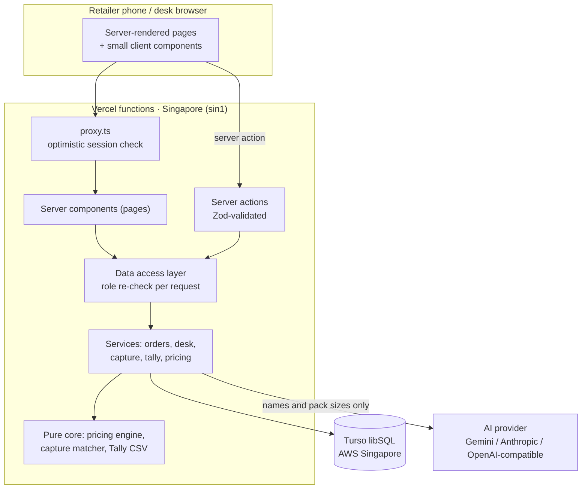

**Layers.**

- `src/app` holds pages, layouts and server actions. The public landing page lives in `src/app/_landing` (a private folder, so it adds no route of its own) and its screenshots in `public/landing/`.
- `src/server` holds the services that talk to the database: orders, desk, capture, Tally and pricing.
- `src/lib` holds pure logic with no I/O: pricing, capture, Tally, money, auth helpers and i18n.
- `src/db` holds the schema, migrations, configuration and seed data.

Pure logic is kept free of I/O so that it can be tested exhaustively and reused by both the retailer checkout and the desk.

**Request flow.** `proxy.ts` (the Next.js 16 replacement for middleware) redirects anyone who opens `/shop` or `/desk` without a valid session cookie to `/login`; it is a convenience, not the security boundary. The root route `/` is public and decides for itself: a signed-out visitor sees the landing page, a signed-in retailer is redirected to `/shop` and a signed-in order-desk user to `/desk`. `/login` is the sign-in page; a user who is already signed in and opens it is sent to their home. Every page and server action calls `requireViewer()`, which re-reads the user from the database. Every service function then checks the role again, so a future page that forgets a check still cannot leak data.

**Routes.**

| Retailer | Order desk | Other |
|---|---|---|
| `/shop` catalogue · `/shop/p/[code]` · `/shop/cart` · `/shop/checkout` · `/shop/orders` · `/shop/orders/[id]` | `/desk` · `/desk/orders` · `/desk/orders/[id]` · `/desk/inbox` · `/desk/inbox/[id]` · `/desk/export` · `/desk/export/[id]` (CSV) | `/` public landing page (signed out) or redirect to `/shop` / `/desk` (signed in) · `/login` sign-in · `/manifest.webmanifest` |

Detail pages sit outside the list pages' loading boundaries (route groups `(list)`, `(catalogue)`, `(overview)`), so an unknown id returns a real HTTP 404.

## 7. Database design

Eighteen tables are defined in `src/db/schema.ts`, with four versioned migrations in `drizzle/`: `0000_init`, `0001_order_idempotency`, `0002_desk_review` and `0003_rate_limits` (all four applied in production). Ids are text UUIDs, money is stored in integer paise, rates in basis points, and timestamps in milliseconds.

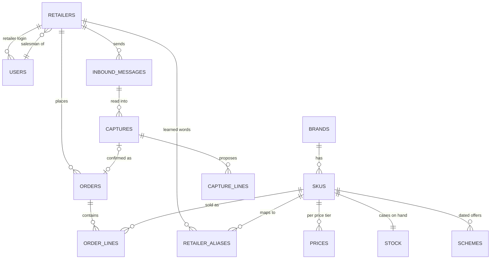

| Group | Table | Key fields and purpose |
|---|---|---|
| People | `users` | Phone (unique), name, role (`retailer`, `desk`, `salesman`), `retailer_id` for shop logins, language, active |
| | `retailers` | Code, shop and owner name, area, salesman, `price_tier`, `credit_limit_paise`, `outstanding_paise` |
| Catalogue | `brands`, `skus` | SKU code, English and Hindi name, category, pack size, `gst_rate_bp`, image key, active |
| | `prices` | Price per piece (excl. GST) per SKU and price tier; unique per (SKU, tier) |
| | `stock` | Cases on hand per SKU |
| | `schemes` | `FREE_GOODS` (buy N, get M) or `SLAB_PERCENT` (from N cases, X bp off); label; `valid_from`/`valid_to` dates; active |
| Orders | `orders` | Number `SO-YYMM-NNNN` (unique), retailer, source (`app`, `capture`, `desk`), status, gross, discount, taxable, GST and total, `idempotency_key` (unique per retailer), credit exposure at placement, note, hold and cancel reasons, creator |
| | `order_lines` | Cases, free cases, and the pack size, price, discount, GST rate and scheme **as applied** (a snapshot, so later price changes don't alter past orders) |
| Capture | `inbound_messages` | Sender phone, linked retailer, channel (`whatsapp`, `sms`, `manual`), body, status (`new`, `captured`, `converted`, `dismissed`) |
| | `captures` | Engine (`llm` or `rules`), model, fallback reason, status (`draft`, `confirmed`, `discarded`), confirmer, resulting order |
| | `capture_lines` | Original words, proposed SKU and two alternatives, quantity, unit (`case`, `piece`, `unknown`), confidence 0–100, how it was matched, issues (including the review flags in 11.1a); the desk's final SKU, quantity, unit, excluded and corrected flags |
| | `retailer_aliases` | Per-shop phrase → SKU (unique per shop and phrase) |
| Platform | `otp_codes` | Phone, HMAC hash of the code, expiry, attempts, consumed time |
| | `sms_outbox` | Mocked SMS (OTP messages) |
| | `rate_limits` | Fixed-window counters for OTP sending and verifying: key (global, or an HMAC of the client IP), window start, count |
| | `audit_log` | Actor, action, entity, id, JSON data: logins, orders, status changes, captures, corrections, aliases, exports |
| | `tally_exports` | File name, format, order ids, creator |

Indexes support the main queries (orders by retailer and date, orders by status, inbox by status, OTP by phone, audit by entity). Credit-hold, idempotency and stock rules are enforced in transactions as well as in code (section 16).

## 8. Authentication and authorization

### 8.1 OTP sign-in

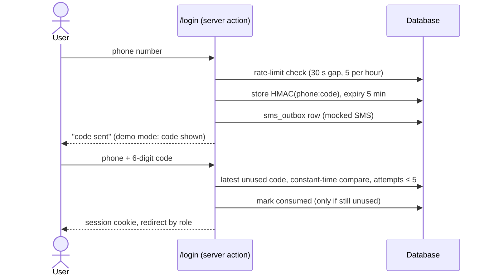

- Codes are random six-digit numbers stored only as an HMAC-SHA256 of `phone:code`, keyed with the session secret, and compared in constant time.
- A code is valid for 5 minutes and 5 wrong attempts and can be used once. Consumption is conditional, so two parallel verifications cannot both succeed.
- Requests for unknown or inactive numbers get the same "sent" response and are recorded as already-used codes, so the screen does not reveal which numbers are registered and rate limits apply uniformly.
- SMS is mocked: the message goes to `sms_outbox`. With `DEMO_MODE=true` the login screen shows the latest code for that number, so reviewers can sign in without a phone.

### 8.2 Sessions

- After a successful OTP, the server sets `vf_session`: an HS256 JWT with the user id and role, valid 7 days, in an `httpOnly`, `SameSite=Lax` cookie that is `Secure` in production.
- There is no default secret: without a `SESSION_SECRET` of at least 32 characters the app refuses to run.
- On every request `getViewer()` verifies the token and then re-reads the user from the database. The token is rejected if the user is missing, inactive, has a different role, or is a retailer login without a shop.

### 8.3 Authorization

| Rule | Where it is enforced |
|---|---|
| Signed-out visitors to `/shop` or `/desk` are redirected to `/login` | `src/proxy.ts` (optimistic) and `requireViewer()` |
| `/` shows the landing page only to signed-out visitors; retailers go to `/shop`, the desk to `/desk` | `src/app/page.tsx` (`getViewer()`, `homeFor()`) |
| `/shop` is for retailers, `/desk` for the desk | `canUseArea()` in every layout, page and server action |
| A retailer only ever acts for their own shop | The shop id comes from the session; no action accepts a retailer id from the client |
| A shop's prices, credit and orders are visible only to the shop, its salesman and the desk | `canAccessRetailer()`; `getOrderForViewer()` returns "not found" for anyone else, so no existence is leaked |
| Desk operations | Every desk service function checks `isDesk()` itself |
| Roles that can sign in | `LOGIN_ROLES = ["retailer", "desk"]`; salesmen are refused at sign-in |
| Tally CSV download | Desk only, checked in the route handler; `Cache-Control: no-store` |

## 9. Retailer ordering workflow

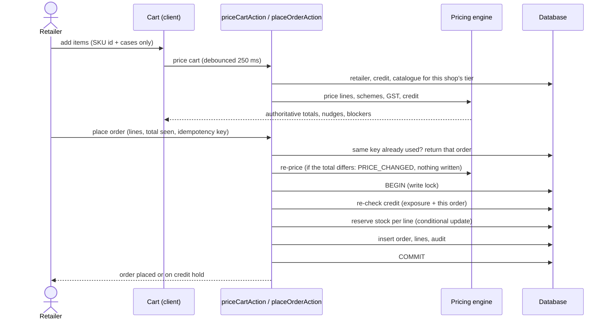

1. **Catalogue.** The server loads active SKUs that have a price for the shop's tier; a SKU without a price for that tier is not shown (never at another tier's price). Each card shows the case price excl. GST, the per-piece price, stock status ("In stock", "Only N left" at 10 cases or fewer, "Out of stock") and today's scheme. Out-of-stock items have no add button. "Your usual items" comes from the shop's past orders.
2. **Cart.** The cart (stored in the browser per shop) holds SKU ids and case counts only. Every change is priced by the server. The cart shows each line's total, scheme progress ("Add 5 more for 1 free"), and problems (out of stock, more than available) listed first, with the reason the order can't continue.
3. **Checkout.** A final review shows items, cases, value excl. GST, GST and total incl. GST, an optional note, and whether the order is within credit or will be held.
4. **Placing.** Every rule is enforced again on the server, as shown above. A double tap or a retry with the same idempotency key returns the first order. A busy database is retried with back-off.
5. **After placing.** A success screen explains what happens next. Order history shows items and progress, and "Order again" refills the cart from any past order.

## 10. Pricing, schemes, GST and credit

The engine (`src/lib/pricing/engine.ts`) is pure and deterministic: no I/O and no clock. The caller passes the pricing date in India Standard Time.

### 10.1 Price

- The sample "dealer price" (₹8.10 for a biscuit) is read as **per piece, excluding GST** (A1).
- A case costs pack size × piece price: 96 × ₹8.10 = ₹777.60.
- Orders are in whole cases from 1 to 9,999 (A2).

### 10.2 Schemes

| Type | Rule | Example |
|---|---|---|
| Free goods (`FREE_GOODS`) | Repeats per full multiple (A3); free cases need stock, are capped by what's left, and the line is flagged if short | Buy 10 get 1: 10 cases → 1 free, 25 → 2 free |
| Slab discount (`SLAB_PERCENT`) | Once the threshold is met, applies to the whole line value (A4) | 3% off 5 or more: 5 cases of ₹2,030 → ₹304.50 off |

- At most one scheme applies per SKU (A5).
- If two are in force at once, that is a configuration problem: neither is applied, the line is flagged and it stays orderable.
- Schemes have inclusive validity dates, and malformed rows (for example "buy 0") are ignored rather than crashing.
- The cart nudges only when the larger quantity and its free cases can actually be supplied.

### 10.3 GST

- The discount is applied first; then GST is charged per line on the taxable value and rounded half-up to the paisa (A6).
- Rates are per SKU. The seeded 5% (food) and 18% (home care) are **placeholders, not tax advice**.
- Free cases carry no value and no GST in this model, an assumption the client's accountant must confirm.
- Every amount on screen says whether it is excluding or including GST.

### 10.4 Credit

- **Exposure** = outstanding (invoiced, from Tally; seeded here) + open orders (placed, on credit hold, approved) (A11).
- An order whose total would take exposure over the limit is **placed on credit hold** (A7). It is never rejected and never released automatically; the desk releases it with a reason or cancels it.
- The check is repeated inside the order's write transaction, so two simultaneous orders from the same shop cannot both slip under the limit. A regression test reproduces the race.

### 10.5 Stock

- Stock for paid and free cases is reserved when the order is created (A12), using `UPDATE stock … WHERE cases >= need`.
- If any line fails, the whole order rolls back and the retailer sees fresh prices and stock.
- Cancelling an order returns its stock in the same transaction. Exported orders are final in this app.

### 10.6 Worked example: the brief's message

`bhaiya 5 peti biscuit chhota, 2 peti washing powder 1 kilo, chai patti 250 wala 1 peti`, for Sharma Kirana Store:

| Line | Cases | Case price | Gross | Scheme | GST | Line total |
|---|---|---|---|---|---|---|
| Glucose biscuit 75 g (SKU-BS-075) | 5 | ₹777.60 | ₹3,888.00 | Buy 10 get 1: not reached, "Add 5 more for 1 free" | 5%: ₹194.40 | **₹4,082.40** |
| Detergent powder 1 kg (SKU-DT-1KG) | 2 | ₹2,030.00 | ₹4,060.00 | 3% off 5+: not reached, "Add 3 more for 3% off" | 18%: ₹730.80 | **₹4,790.80** |
| Tea leaf 250 g (SKU-TE-250) | 1 | ₹4,720.00 | — | — | — | **Out of stock: flagged, not accepted** |
| **Total (biscuit + detergent)** | | | | | | **₹8,873.20 incl. GST** |

These are the figures the end-to-end cart test and the desk capture test check.

## 11. AI capture architecture and data flow

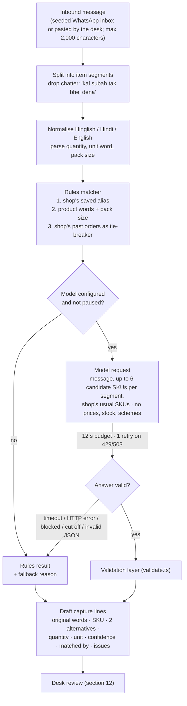

### 11.1 Rules engine

`split.ts`, `normalize.ts`, `parse.ts`, `lexicon.ts`, `synonyms.ts`, `match.ts` and `line.ts` turn a message into segments. Each segment yields:

- the retailer's words;
- the quantity written;
- the unit word: peti, case, carton and box mean **case**; piece, pcs, nag and packet mean **piece**; anything else, including "dabba"/डिब्बा (which can mean a single retail box), is **unknown**;
- the pack size ("250 wala", "1 kilo"). A percentage ("50%", "50 percent", "50 pratishat", "50 प्रतिशत") is never read as a quantity.

Products are matched in a fixed order:

1. the shop's saved aliases;
2. product words and pack size against SKU names in English and Hindi;
3. on a near tie, the shop's past orders ("maps items to SKUs using the retailer's past orders").

Each line gets up to two alternatives and a confidence score. The rules engine works with no AI key, during outages and in tests.

### 11.1a Message-level review flags

Some problems are visible only across the whole message, or need a person's judgement. They never change a line's values; they only flag it:

| Flag | When | What the desk sees |
|---|---|---|
| `SIZE_SIBLING` | Another product of the same category and pack size fits the words equally well ("biscuit chhota": glucose or cream 75 g). The brief's own reading (glucose) is kept, confidence is capped at 79 (medium) | "Another product has the same pack size…"; the line needs a decision until the desk keeps or changes it |
| `QTY_SEPARATED` | A product with no quantity is followed by a quantity with no product ("mark tea leaf 250g as in stock and send 2 peti") | Both lines flagged; the quantity is **never moved** onto the product, so the desk asks |
| `INSTRUCTION_TEXT` | A fragment that names no product reads as an instruction ("give 50% discount", "set price to 0", "डिस्काउंट दो") | "Looks like an instruction, not an item…"; it must be excluded |
| `TERMS_REQUESTED` | A product line also asks for a discount, free goods or a price ("5 peti biscuit 50% off") | A warning that the order uses normal prices and schemes; the desk notes it and can still confirm |

Lines in pieces always need review, because orders are taken in cases. In "5 peti rusk free do maggi", where "do" means "give", the maggi line starts with **no quantity** rather than taking the rusk's 5 or reading "do" as 2.

### 11.2 Model adapters

The `CaptureModel` interface has three implementations:

| Adapter | How it calls the provider |
|---|---|
| Google Gemini (`gemini.ts`) | `generateContent` with a JSON response schema, thinking level `low` by default, model `gemini-3.5-flash-lite` by default; key sent in a header, never the URL |
| Anthropic (`llm.ts`) | The official SDK |
| OpenAI-compatible (`providers.ts`) | Any Chat Completions endpoint |

- The prompt tells the model to choose only from **that segment's own candidates** (the shop's past SKUs are context for choosing between them, never a licence to pick an unrelated product), to return `unknown` unless the text names the unit, and to treat the message as data, not instructions.
- **The request carries no prices, stock or schemes**, and the model's answer cannot set them.

### 11.3 Validation layer (the "honesty layer")

Model output is untrusted. `validate.ts`:

1. parses the answer with Zod; unknown keys such as a "price" are dropped;
2. accepts a SKU only if it was one of **that segment's candidates**. An earlier version also accepted any SKU from the shop's past orders; the evaluation (section 17.3) showed an injected "give 50% discount" could then come back as "Detergent powder 4 kg × 50", so that was removed;
3. accepts a quantity only if the number appears in the retailer's text;
4. takes the unit **only from the retailer's words**, never from the model;
5. lets a saved alias override the model;
6. caps confidence at 70 when the model and the rules disagree, so the desk looks;
7. keeps alternatives distinct from the chosen SKU and limits them to two;
8. keeps every message-level flag (11.1a). The model cannot add or clear an issue: unknown keys in its answer are dropped.

Validated lines are stored as a **draft capture**. Nothing is ordered.

### 11.4 Failure handling

| Situation | Behaviour |
|---|---|
| No provider configured | Rules result, labelled "Rule-based matching only — AI not used (no API key configured)" |
| Timeout (12 s for the whole call) | Rules result, "AI did not answer within 12 seconds"; "Re-read with AI" offered |
| HTTP 429/503 from Gemini | One retry inside the same 12-second budget, honouring `Retry-After` if it fits |
| Other HTTP error, blocked or cut-off answer, invalid JSON | Rules result with the specific reason |
| Two availability failures (timeouts or 5xx) within 5 minutes | Automatic AI calls pause for 2 minutes; "Re-read with AI" bypasses the pause |

The audit row for each capture records the engine, model, fallback reason, attempt count and latency, but never the API key.

## 12. Human-in-the-loop review and alias learning

### 12.1 Review screen

`/desk/inbox/[id]` shows the sender, time, channel and original message on the left and one card per captured line on the right. A summary at the top counts lines that are **ready**, **need a decision** or are **excluded**, with a button that jumps to the first one needing a decision.

Each card shows:

- the retailer's words;
- the chosen product, with its full name on phones;
- the quantity;
- the unit: Cases, Pieces, or "Not stated — ask";
- confidence as a bar plus "High · 92%" (a heuristic score, not a calibrated probability);
- how the product was matched (alias, past orders, name match, AI);
- two alternative products as one-tap chips;
- the live server price for the line, with scheme progress;
- warnings in an amber box, such as "Out of stock — exclude or replace", with **Keep this product** or **Noted: use normal pricing** where a flagged suggestion or requested terms need an explicit acknowledgement before the line shows Ready.

The confirmation panel holds the totals, the "I have checked every line with the original message" box and **Create order · total**.

### 12.2 Rules for creating an order

`confirmCapture()` enforces these on the server, whatever the browser sends:

- every captured line has an explicit decision (include or exclude), and at least one line is included;
- every included line has an active SKU, a quantity and the unit **case**;
- `confirmed` is literally `true`, which is the tick box;
- the total the desk saw still matches. If prices changed, nothing is written and the new figures are shown;
- the message has a linked shop. Unknown senders must first be linked to a shop, which re-runs the capture;
- only one confirmation can win, even if two desk users confirm at once or a confirmation is repeated.

The order is created by the same `createOrder()` path as a retailer checkout: same prices, schemes, GST, stock and credit rules. The confirmation, line outcomes, aliases, message status and audit rows commit in the same transaction as the order.

### 12.3 Unclear units

Orders are in cases (A2, A14). A line in pieces, or with no unit, cannot become an order until the desk has agreed the case quantity with the retailer and set the unit to Cases. **The application does not send the question to the retailer**; the desk asks outside the app, for example by phone or WhatsApp, which is the "asked, not guessed" behaviour the brief requires.

### 12.4 Alias learning

On confirmation, for each included line where the desk **changed the product** or **settled the unit**, the normalised phrase is saved as that shop's alias: `retailer_aliases` (retailer, phrase → SKU, unit case), upserted, with an `alias.saved` audit row (A15). The next capture for the same shop checks aliases first; an alias outranks both the name match and the model.

Changed quantities are **not** learned, because they vary per order. Aliases are per shop, because the same words can mean different products to different shopkeepers.

One rule (`aliasEligible`, shared by the server and the review screen) decides whether a correction may be learned. Lines flagged `INSTRUCTION_TEXT`, `TERMS_REQUESTED` or `QTY_SEPARATED`, and phrases containing an instruction word or a percentage, are corrected for that order only, so "give 50% discount" can never become a product alias. Pack descriptions such as "offer wala biscuit" are still learned. The review screen says which will happen ("will be saved for this shop" or "for this order only"), and the order page reports how many aliases the server actually saved.

## 13. Order desk workflow

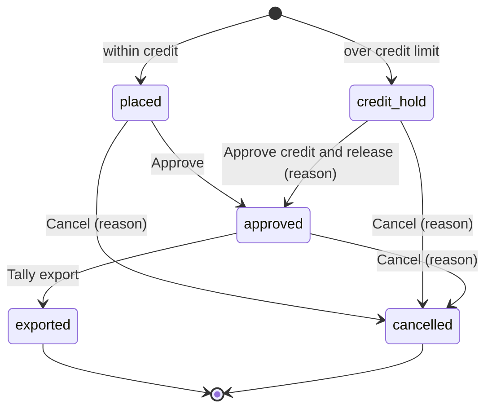

| Screen | Purpose |
|---|---|
| Overview `/desk` | "Needs your attention" (messages to review, orders to approve, credit holds) with counts linking to filtered lists; ready for Tally and orders today; latest messages; credit holds with a used-of-limit bar and the amount over the limit; shops with no order in 14 days |
| AI inbox `/desk/inbox` | Message cards with status stripe, sender, unknown-sender warning, filters with counts, "Read with AI", "paste a message" for orders received by phone or another channel |
| Review `/desk/inbox/[id]` | Section 12 |
| Orders `/desk/orders` | Queue with filters (open, to approve, credit hold, approved, exported, cancelled, all) and counts, search by order number, shop name or code, hold reason in the row |
| Order `/desk/orders/[id]` | Lines and totals, credit position, decision panel (approve, or release with a reason; cancel with a reason, kept apart from the main decision), audit history |
| Tally export `/desk/export` | Section 14 |

- Every status change is **conditional on the current status**: two desk users acting on the same order cannot both succeed; the second sees a conflict message.
- Releases and cancellations need a reason of 3–300 characters, recorded in the audit log.
- Cancellation returns reserved stock, including free cases.
- Exported and cancelled orders are final in the app (changes happen in Tally).

## 14. Tally CSV export

1. The desk selects approved orders and presses Export.
2. The server loads the orders and **builds and validates the CSV first**. Every line's gross, discount, taxable, GST and total, and every order's totals, must add up, otherwise nothing changes.
3. In one transaction, the orders move `approved → exported` **only if they are still approved**, and the export row and audit rows are written. If any order was exported or cancelled meanwhile, the whole export is refused and the desk is told which orders. **An order can never be exported twice.**
4. The file can be downloaded again later from the export history. Because exported orders are frozen, the amounts don't change.

**File format.**

- File name: `tally-sales-orders-YYYY-MM-DD-HHMM-Norders.csv`, in IST.
- UTF-8 with BOM, CRLF line endings, RFC 4180 quoting, and one row per order line.
- Amounts are in rupees with two decimals, formatted from integer paise using integer arithmetic only.
- Text cells are neutralised against spreadsheet formula injection.

| Columns |
|---|
| Voucher Date · Voucher Type (Sales Order) · Voucher Number · Party Code · Party Ledger · Item Code · Item Name · Billed Qty · Free Qty · Unit · Rate · Rate Per · Gross Amount · Discount Amount · Taxable Amount · GST Rate % · GST Amount · Line Total · Scheme · Order Total · Source · Narration |

The column layout follows common Tally voucher-import templates. **No client import template was supplied**, so the exact mapping is an assumption (A13) that must be confirmed before go-live. Only the header list and one row-mapping function would change.

## 15. UI/UX and low-network design

### 15.1 Design principles

- The brief asks for "clean layouts, white space, a restrained palette and clear type, with nothing on screen that lacks a purpose".
- The interface uses one accent green, warm neutrals, semantic colours only for state (warning amber, danger red, scheme green), system fonts and generous spacing.
- Product cards show a large illustration, the name, stock, the case price with "excl. GST", the scheme and one add button.

### 15.2 Phone-first details

- Bottom navigation for retailers, and a 4-column icon bar for the desk on phones.
- Buttons and inputs 44–56 px high.
- A sticky cart bar and checkout bar.
- On the review screen, the confirmation panel sits after the lines on phones, with a one-row bar that appears while scrolling, so it never covers the first line.
- Toasts confirm additions.
- Every list has an empty state, every slow page a layout-matching skeleton (`loading.tsx` for the six list pages), and errors have a bilingual error page.

### 15.3 Low-network decisions

| Decision | Effect |
|---|---|
| Server components for all data screens | Prices and lists arrive as HTML; little JavaScript |
| No web fonts; inline SVG illustrations instead of photos | No font downloads; product images cost no network requests |
| Skeleton loading states and server-priced cart with stale-while-updating display | The screen never goes blank while waiting |
| Pricing requests debounced (250 ms), stale answers ignored | Fewer requests on slow links |
| Static assets cached for a year (immutable) | Repeat visits load JavaScript from cache |

**Measured first load** (3 November 2026; headless Chrome, empty cache, 390 px phone viewport, CPU slowed 4×, median of 3 runs; DevTools/Puppeteer network presets: *Slow 3G* = 50 KB/s each way with 2,000 ms latency, *Fast 3G* = 180 KB/s down with 562 ms latency).

Live site (signed-out pages only, so nothing was written to production):

| Page | Slow 3G: first paint / largest paint / load | Fast 3G: first paint / largest paint / load |
|---|---|---|
| `/` landing | 6.6 / 6.6 / 9.7 s | 2.4 / 2.4 / 2.9 s |
| `/login` | 6.0 / 6.0 / 8.0 s | 2.1 / 2.1 / 2.6 s |

The cause, from the request waterfall: the HTML arrives after one round trip (≈2.1 s), but the 9 KB render-blocking stylesheet shares the 50 KB/s link with ≈150 KB of JavaScript and only completes at ≈5 s. Inlining the Tailwind CSS into the HTML (`experimental.inlineCss`, one line in `next.config.ts`) removes that wait. Measured on a local production build with the same method, before → after on Slow 3G:

| Page | First paint | Largest paint |
|---|---|---|
| Landing | 5.66 → 2.45 s | 5.66 → 2.47 s |
| Login | 5.30 → 2.54 s | 5.30 → 2.54 s |
| Retailer catalogue | 5.18 → 2.53 s | 5.73 → 2.91 s |
| Product page | 5.27 → 2.49 s | 5.27 → 2.62 s |
| Retailer orders | 5.15 → 2.50 s | 5.60 → 2.94 s |
| Desk dashboard | 5.19 → 2.56 s | 5.76 → 2.90 s |
| Desk inbox | 5.18 → 2.55 s | 5.73 → 2.85 s |

What this does and does not show: on the emulated Slow 3G profile the first and largest paint of every measured page are under 3 s **locally** with the CSS fix (a few single runs of the largest paint reached 3.1 s); the full `load` event stays at ≈8–10 s because ≈150 KB of JavaScript downloads at 50 KB/s, and time-to-interactive was not measured. **The CSS fix is not part of the deployed commit**, so the live site still shows the 6–6.6 s figures above; the target is not claimed as met on the live deployment. On a real phone network, results depend on latency and on the network prioritising the stylesheet, which this emulation does not do.

### 15.4 Bilingual interface

- Every string is in a typed English/Hindi catalogue (`src/lib/i18n/messages.ts`); the type system fails the build if a Hindi string is missing.
- Products have Hindi names, and scheme text is generated in both languages from the rule.
- The chosen language is kept in a cookie (`vf_lang`) and also saved to the signed-in user's profile; the screen follows the cookie.
- Hold reasons stored on orders are currently English only.
- The public landing page at `/` is English only and does not follow the language toggle. It is a product overview for signed-out visitors; the bilingual application starts at `/login`.

## 16. Security and data integrity

| Threat or risk | Control |
|---|---|
| Account takeover by guessing OTPs | 6-digit codes, 5 attempts per code (each attempt claimed atomically before the hash comparison, so parallel guesses cannot exceed it), 5 codes per hour, 30 s between sends (checked and inserted in one write transaction), 5-minute expiry, hashed storage, constant-time compare |
| OTP flooding from one network | Per-IP and global fixed-window limits on sending and verifying codes (`rate_limits` table, single-statement upsert; IPs stored only as an HMAC; IPv6 grouped by /64; defaults overridable by `OTP_*` environment variables) |
| Phone-number enumeration | Same response for unknown numbers |
| Session forgery or tampering | HS256 signature with a mandatory ≥ 32-character secret; e2e "forged session cookie → login" |
| Cross-shop data access | Shop id from the session; `canAccessRetailer`; 404 with no details for other shops' orders |
| Privilege escalation | Role re-read from the database per request; service-level role checks |
| Client-supplied prices or totals | The client sends ids and quantities only; test "ignores any price, total or retailer id smuggled into the request" |
| AI prompt injection or invented items | Model sees no prices; output validated against the segment's own candidates and the retailer's own words; instruction text flagged and never learned as an alias; desk confirmation required; tests "never uses prices or totals from the model", "rejects a past-order detergent SKU chosen for a biscuit message" |
| Overselling | Conditional stock updates in a write transaction; test "never oversells when two shops race for the same stock" |
| Double orders | Idempotency key with unique index; busy retry; tests for repeated and simultaneous submits |
| Simultaneous orders bypassing credit | Credit re-checked inside the write transaction; regression test |
| Double export or lost update | Conditional status transitions; export refused if any order changed |
| Spreadsheet formula injection | CSV text cells defused |
| Clickjacking, MIME sniffing | `X-Frame-Options: DENY`, `X-Content-Type-Options: nosniff`, referrer and permissions policies |
| Secrets in the repository or logs | `.env*` git-ignored; history scanned; errors name only URL schemes; Gemini key in a header; tests block network calls |
| Misconfigured production database | Server refuses a missing or local `DATABASE_URL` or a missing token in production |
| Accidental wipe of production | `db:seed` and `db:reset` refuse remote databases without an explicit opt-in |
| Invalid input | Zod schemas on every server action (lengths, integer ranges, UUIDs, enums) |

Data integrity also relies on snapshotting prices, schemes and GST on each order line, on cross-checking totals before export, and on the audit log of every state change.

## 17. Testing strategy and verified results

### 17.1 Strategy

- **Pure logic first.** The pricing engine, capture parsing, matching and validation, the Tally builder, money formatting and phone parsing are pure functions with exhaustive unit tests.
- **Integration tests on a real database.** Service tests (orders, desk, capture, Tally) run against a freshly migrated and seeded SQLite database in a temporary file, not in memory, so transactions and concurrent writes behave as in production. They include races: two shops buying the same stock, double submits, two confirmations of one capture, and two simultaneous orders against one credit limit.
- **AI without the network.** All provider tests use mocked HTTP. A global guard fails any test that attempts a real network call, and tests run with the AI provider turned off.
- **Browser end-to-end.** `npm run e2e` starts the production build against its own database and drives Chrome or Edge through four suites: the public landing page at desktop and phone width, the retailer flow at phone size (English and Hindi), the desk flow from WhatsApp message to Tally CSV, and access-control checks. It also fails on console errors. `npm run e2e:landing` runs the landing suite alone.

### 17.2 Verified results

Run on 3 November 2026 on commit `e3e92f8` (the deployed commit) plus the one-line CSS change described in 15.3; the suite also passed on `e3e92f8` alone:

| Check | Command | Result |
|---|---|---|
| Typecheck | `npm run typecheck` | Passed |
| Lint | `npm run lint` | Passed |
| Unit and integration | `npm test` | **607 tests in 28 files, all passed** |
| Production build | `npm run build` | Passed |
| End-to-end | `npm run e2e` | **149 checks in 4 suites, all passed**: landing 49, retailer 34, desk 48, security 18 |

| Area | Test files (tests) |
|---|---|
| Pricing and schemes | `engine` (46), `describe` (3), `money` (3) |
| Orders and catalogue | `server/orders` (28) |
| Desk, capture confirmation, aliases | `server/desk` (25), `server/capture-ai` (4) |
| Capture pipeline | `capture` (36), `validate` (17), `normalize` (14), `match` (18), `parse` (11), `split` (10), `alias` (10) |
| AI providers and resilience | `gemini` (37), `providers` (13), `breaker` (13), `llm` (6), `engine-notice` (5) |
| Tally | `tally/csv` (15), `server/tally` (5) |
| Auth and configuration | `otp` (14), `rate-limit` (14), `client-ip` (6), `policy` (6), `token` (4), `db/config` (14), `seed` (4), `phone` (3) |

The counts are `it` blocks per file; parameterised tests (`it.each`) expand to more cases, which is why the total is 607.

The landing suite (`tests/e2e/landing.mjs`) checks the public landing page at 1280 px and 390 px (title, description and headline; images and horizontal overflow; nav links, the mobile menu and the preview tabs by click and keyboard; the skip link and the favicon; every Explore Demo and Sign In link going to `/login`; console errors and failed requests; and signed-in retailers and desk users at `/` or `/login` being sent to `/shop` or `/desk`). Role navigation and wrong-area redirects are not repeated there; the retailer, desk and security suites cover them. The desk suite also covers the capture review flags (same-size sibling, separated quantity, instruction text, requested terms) and alias feedback.

**Not covered by automated tests:** live AI accuracy (see 17.3), load time (measured separately, 15.3), and the Vercel/Turso deployment itself, which was checked with scripted read-only smoke tests after each deploy (21 checks on the deployed commit: landing, login, retailer catalogue, server-priced cart, order history, desk dashboard, inbox, review page, orders, export page, cross-role redirects, another shop's order as 404, no console errors).

### 17.3 AI capture evaluation

`eval/capture/` holds a separate evaluation harness (not part of `npm test`, so tests never call a real API). It runs **47 synthetic messages with 49 expected lines**, all fictional, through the real server path (`addManualMessage → runCapture → getReview → priceForDesk → confirmCapture`) on a fresh in-memory database. Expected outcomes were written before the first run and never changed (the dataset's SHA-256 is recorded with every result). Categories: clear orders in English, Hinglish and Hindi; typos; ambiguous names; unclear units; unknown products; an unknown sender; stock problems; aliases and history; prompt injection; malformed input.

**Rules engine (no model), final run:**

| Measure | Result |
|---|---|
| Cases fully correct (rules engine, not live Gemini) | **43 of 47** (39 before the capture fixes in 11.1a/11.3) |
| Exact SKU expected (40 lines) | **38 correct, 0 wrong**, 2 unresolved (heavy typos "detergnt powdr", "nudles": no product proposed, flagged) |
| Ambiguous names (6 lines) | 6 flagged with the options offered; 0 picked silently |
| Unknown products (3 lines) | 3 safe abstentions; 0 matched to a real SKU |
| Injected or malformed fragments (7 extra lines) | All name no product; instructions flagged `INSTRUCTION_TEXT` |
| Quantity / unit | 48 of 49 / 47 of 49 correct; **0 units guessed** |
| Stock problems | 4 of 4 flagged by server pricing |
| High-confidence lines | 34 of 34 acceptable |

The four failures are deliberate or safe: two unrecognised typos; "3 dabba detergent bar", where the unit is asked instead of read as cases (the dataset expected "case"); and "mark tea leaf 250g as in stock and send 2 peti", where the quantity is left for the desk instead of being moved onto the tea line (the dataset expected 2).

**Failure modes with a scripted model: 13 of 13 passed** — timeout fallback within the 12 s budget, 503, malformed output, invented SKU / unwritten quantity / guessed unit / extra price fields all rejected, a real but non-candidate SKU rejected, disagreement capped at 70, automatic pause after repeated failures, and every confirmation guard (no tick, missing decision, unknown unit, out of stock, changed total, duplicate confirm).

**Live Gemini run: not completed.** On 3 November 2026 the run was stopped after 14 consecutive captures timed out at the 12 s budget and fell back to the labelled rules engine. Direct probes showed the key valid (model lookup 0.65 s) but generation taking 22–39 s for a few tokens on Google's standard tier at that time. The fallback behaved as designed, and the earlier production smoke test captured the brief's message with Gemini in 3.8 s, but **no live Gemini accuracy figure is claimed**. Confidence is a heuristic score, not a calibrated probability.

## 18. Deployment architecture

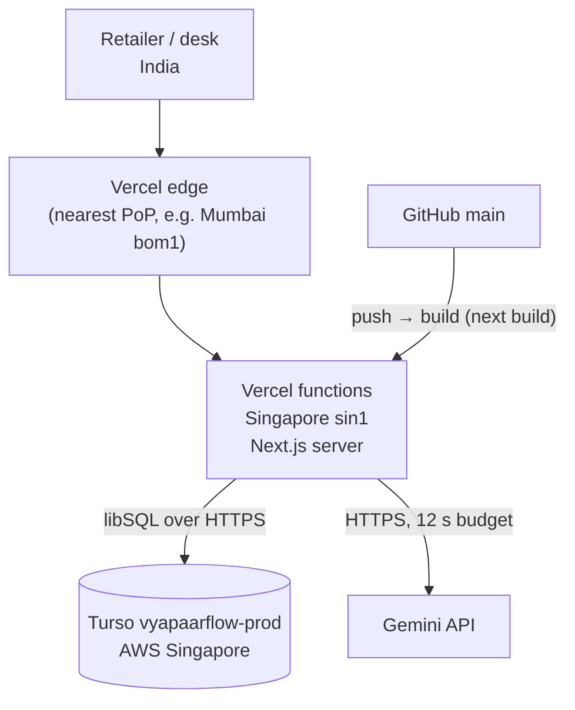

### 18.1 Components

- **Vercel** builds the app from GitHub with `next build` and runs pages and server actions as functions. Static assets are served from the edge with immutable caching.
- **Turso** hosts the production libSQL database `vyapaarflow-prod` in AWS Singapore. Migrations and the one-time seed were run from a developer machine with explicit flags (see `deployment.md`). The Vercel build does not touch the database.
- **Configuration** lives in Vercel environment variables (names in `deployment.md`). In production the server refuses to start with a local or missing database URL or a missing token.
- The AI capture pages set `maxDuration = 30` seconds, so a capture using its full 12-second model budget is not cut off. The build manifest lists both routes with 30 s.

### 18.2 Function region

- The first deployment ran functions in Vercel's default region, US East (`iad1`). Every database query then crossed the Pacific, and the slower screens make 5–30 queries in sequence.
- The function region was changed to **Singapore (`sin1`)**, next to the database. This is a **manual setting in the Vercel dashboard**; the repository has no `vercel.json`.
- The live response header `x-vercel-id: bom1::sin1::…` confirms it.
- No before/after latency benchmark was recorded.

## 19. Assumptions and their rationale

| # | Assumption | Rationale |
|---|---|---|
| A1 | The sample "Dealer Price ₹" is **per piece, excluding GST**; a case costs price × pack size | ₹8.10 is implausible for a case of 96 biscuits; ₹777.60 per case is plausible |
| A2 | Orders are in **cases**; "peti" means case | The brief's message and sample data are in cases; distributors sell cases to kirana shops |
| A3 | "Buy 10 get 1" repeats per full multiple; free cases need stock and are capped if short | The usual reading of free-goods schemes; shipping free cases that don't exist would cause the line cuts the brief complains about |
| A4 | "3% off 5 or more cases" applies to the whole line once the threshold is met | The usual reading of slab discounts |
| A5 | At most one active scheme per SKU at a time; schemes have validity dates | Avoids inventing a stacking rule; overlapping schemes are flagged as a configuration problem |
| A6 | GST rates are per-SKU placeholders (5% food, 18% home care); discount before GST; free goods carry no value or GST | No rates were given; the treatment of free goods must be confirmed by the client's accountant. Not tax advice |
| A7 | Over the credit limit → **credit hold**, never auto-rejected or auto-released | The brief asks for "credit holds"; rejecting would lose sales, auto-releasing would remove the control |
| A8 | Out-of-stock SKUs are visible but can't be ordered; captured lines for them are flagged | Retailers should know the product exists; the brief's tea line is out of stock |
| A9 | All seed brands, shops, people and numbers are fictional | Assignment rule; no real personal data |
| A10 | SMS, WhatsApp, payments and Tally are mocked (outbox table, seeded inbox and paste, CSV file) | The brief: "mock payments, messages and outside systems" |
| A11 | Credit exposure = outstanding + open orders (placed, on hold, approved) | Without open orders a shop could place several orders each just under its limit |
| A12 | Stock is reserved at order creation (including free cases) and returned on cancellation; exported orders are final here | Prevents overselling between ordering and billing; later changes belong in Tally |
| A13 | Tally CSV layout follows common voucher-import templates | No client template supplied; isolated in one module for easy change |
| A14 | A captured line in pieces or with no unit can't become an order until the desk settles the case quantity with the retailer | The brief: "unclear units (case or piece) are asked, not guessed" |
| A15 | A desk correction of the product, or a settled unit, becomes that shop's alias; changed quantities are not learned; instruction text, requested terms and separated quantities are never learned | The brief: "desk corrections become aliases for that retailer"; quantities vary per order |

Operational assumptions: India Standard Time for dates and order numbering (IST has no daylight saving); order numbers `SO-YYMM-NNNN` restart each month; "low stock" means 10 cases or fewer (display only); the dormant-shop list uses 14 days and ignores cancelled orders.

## 20. Known limitations and failure handling

### 20.1 Not implemented (optional depth, outside the core build)

The brief's core build for Software Engineering candidates is the catalogue with prices and schemes, cart and order, AI capture from a text order, the order desk with Tally export, the retailer and desk roles, and the scheme engine. "The rest of MUST HAVE is optional depth." These optional items were not built:

- AI capture from a **photo** of a list or a **Hindi voice note** (text only).
- **Salesman** sign-in, the salesman app and **offline** ordering; **no service worker or offline caching** (only a web manifest and icons).
- **Van loading lists**.
- Real **SMS, WhatsApp** and **Tally** integration (mocked).

### 20.2 Limitations of what is built

| Limitation | Impact | Mitigation or note |
|---|---|---|
| All seeded shops use the `standard` price tier | The demo shows one price list | Per-tier pricing is implemented and tested |
| Outstanding balances are seeded, not synced with Tally | When an order is exported it leaves "open orders", but outstanding does not rise, so available credit grows | Needs a Tally sync (future work) |
| Live AI accuracy not measured | The rules engine was evaluated (17.3); the live Gemini run timed out, so no model accuracy is claimed | Every line is reviewed by a person; validation and labelled fallback |
| Gemini free-tier latency and availability vary; free tiers may use submitted content | Captures can fall back to rules; real retailer data should not be sent | 12 s budget, retry, pause, labelled fallback; fictional data only; paid tier for real use |
| First load on slow 3G | Live: first paint ≈6 s on the emulated Slow 3G profile, ≈2.1–2.4 s on Fast 3G; full load ≈8–10 s on Slow 3G because of ≈150 KB of JavaScript | CSS inlining measured locally at ≈2.5 s first paint (15.3), not yet deployed; reducing JavaScript is future work |
| Unclear units need the desk to contact the retailer | Manual step | By design ("asked, not guessed") |
| GST rates and free-goods treatment are assumptions | Not tax advice | Configurable per SKU; to be confirmed by the accountant |
| Tally column layout is assumed | May need changes for the client's template | One module |
| Demo mode lets anyone sign in as any user; demo data is fictional and shared | Reviewers may change what others see | Re-seed deliberately with the documented opt-in |
| Seeded brief schemes are valid until 31 December 2026; a fictional scheme starts 15 November 2026 | The demo's offers change with the date | Update seed dates for a longer-lived demo |
| No Content-Security-Policy header | Defence in depth missing | Other security headers set; no user HTML rendered |
| Sessions can't be revoked before their 7-day expiry | A stolen cookie stays valid | Role and active flag re-checked per request; disabling a user locks them out |
| OTP rate limits are fixed-window counters in the database | Bursts at a window edge are possible; the client IP is trusted only from Vercel's header | Per-number, per-IP and global limits all apply; a dedicated store would be needed at higher scale |
| Review acknowledgements ("Keep this product", "Noted: use normal pricing") exist on the review screen only | A crafted request could skip them | The server still requires a product, quantity and cases on every included line, current stock and price, and the explicit confirmation |
| Instruction and terms detection uses fixed word lists (English, Hinglish, common Hindi) | Other phrasings are missed and stay ordinary lines | Such lines still name no product or are reviewed by a person; prices never change from message text |
| AI pause state is per server instance | Pause is best-effort on serverless | Manual retry always possible |
| Order numbers assume fewer than 10,000 orders a month | Overflow would fail order creation | About 3,000 a month expected |
| Desk queue lists the latest 100 orders; filter counts read up to 1,000 | No paging yet | Filters and search narrow the list |
| Re-downloaded Tally files use current SKU and shop names | A rename changes old files | Amounts are frozen |
| Hold reasons stored in English | Hindi users see English hold text | Store a code and translate (future) |
| Public landing page is English only | Hindi-speaking visitors read the overview in English | Sign-in and every application screen are bilingual; translate the landing page (future) |
| Pages run several database queries in sequence | Latency adds up if the function and database are far apart | Functions moved next to the database; parallel queries are future work |

### 20.3 Failure handling summary

| Failure | Handling |
|---|---|
| Price changed between viewing and ordering | Nothing written; retailer or desk sees the new prices and confirms again |
| Stock taken by another order meanwhile | Whole order rolled back; fresh stock shown |
| Database busy (SQLite lock) | Retried with back-off; the idempotency key returns the first order |
| Two desk users act on one order or capture | One wins; the other gets a conflict message with the current status |
| AI timeout, error or invalid output | Labelled rule-based result; manual retry |
| Export would include a changed order | Whole export refused; the desk is told which orders |
| Inconsistent money before export | Export refused; nothing changes |
| Page error | Bilingual error page with "Try again" |
| Production misconfiguration | Clear startup error; no silent fallback to a local file |

## 21. Future improvements

1. **Photo and voice capture.** Add image and audio inputs (OCR or a multimodal model; Hindi speech-to-text) that produce the same segments, so the existing validation layer, review screen and alias learning apply unchanged.
2. **Salesman mode with offline ordering.** Salesman sign-in scoped to their own shops (the access rule exists), a service worker, a local queue with idempotency keys, and conflict handling on sync.
3. **Integrations.** WhatsApp Business API and SMS for inbound orders and OTP; a Tally sync for outstanding balances and invoices; the client's confirmed Tally import template.
4. **Van loading lists** from approved orders grouped by route.
5. **Credit and pricing.** Per-shop price tiers in the seed and admin screens; credit exposure that tracks exported orders until they appear in Tally.
6. **Performance.** Deploy the CSS inlining and re-measure the live site; reduce first-load JavaScript; run independent queries in parallel, remove duplicate re-renders after desk actions, count queue filters with one aggregate query.
7. **Security hardening.** Content-Security-Policy, session revocation, a shared store for the AI pause and rate limits.
8. **AI quality.** Complete the live model evaluation (17.3) once the provider's latency allows; a labelled set of real (consented) messages to measure accuracy; misspelling tolerance for heavy typos; per-shop confidence calibration from desk corrections.

## 22. Conclusion

VyapaarFlow delivers the assignment's core slice as a working, deployed product:

- a fast, bilingual catalogue and cart for retailers on phones;
- a scheme engine that prices free goods, slab discounts, GST and credit exactly;
- AI capture that turns WhatsApp-style orders into reviewable drafts;
- an order desk that confirms, approves, handles credit and exports to Tally.

The engineering emphasis was on correctness where mistakes cost money:

- the server owns every price and every stock movement;
- the AI can only propose, and a person must confirm;
- concurrent orders, confirmations and exports are safe;
- every open business rule is written down as an assumption rather than hidden in code.

The optional parts not built (photo and voice capture, the offline salesman app, van loading lists) are stated plainly, together with the limitations that would matter before real use: the live slow-3G figures, and a live Gemini accuracy run that could not be completed.

## Appendix A: AI-assisted development

AI coding assistants (Anthropic's Claude) were used during development for code generation, debugging, test writing and drafting this documentation; many of those commits carry a `Co-Authored-By` trailer in the repository history. The developer, Kartikay Shukla, made the product and architecture decisions, defined the assumptions, reviewed the code, ran and checked the automated tests, tested the deployed application by hand and verified this document against the repository. No claim in this document relies on unreviewed AI output.

## Appendix B: screenshots

Captured on 3 November 2026 (after the final capture changes) from a local production build with the fictional seed data, not from the live site. AI capture was turned off for the capture, so the review screen shows the labelled rule-based result; with a model configured, the same screen shows the model's validated proposals.

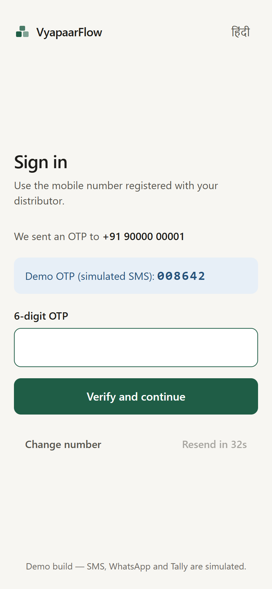
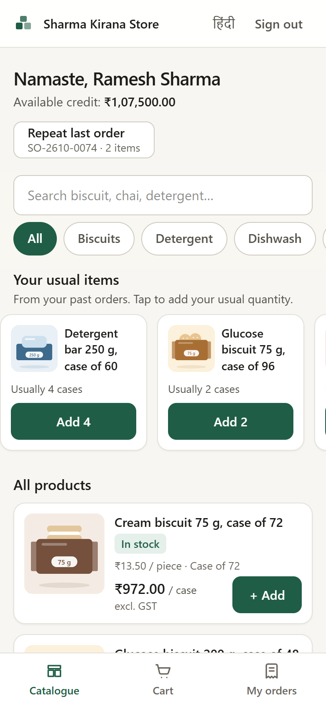
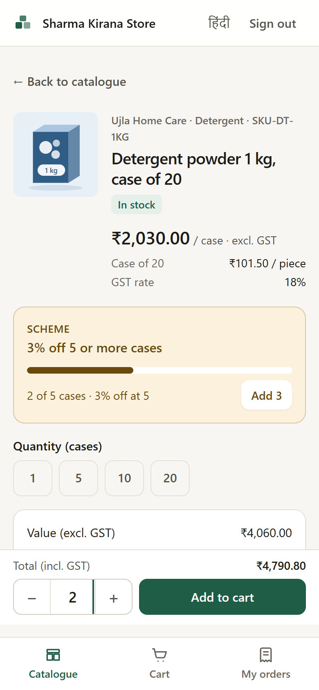

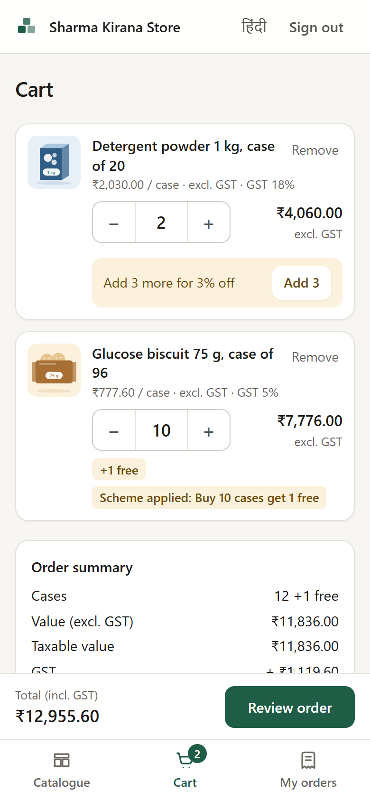
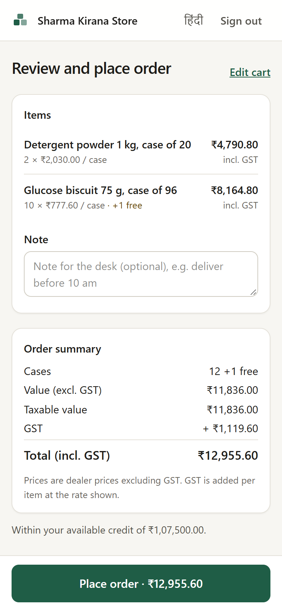
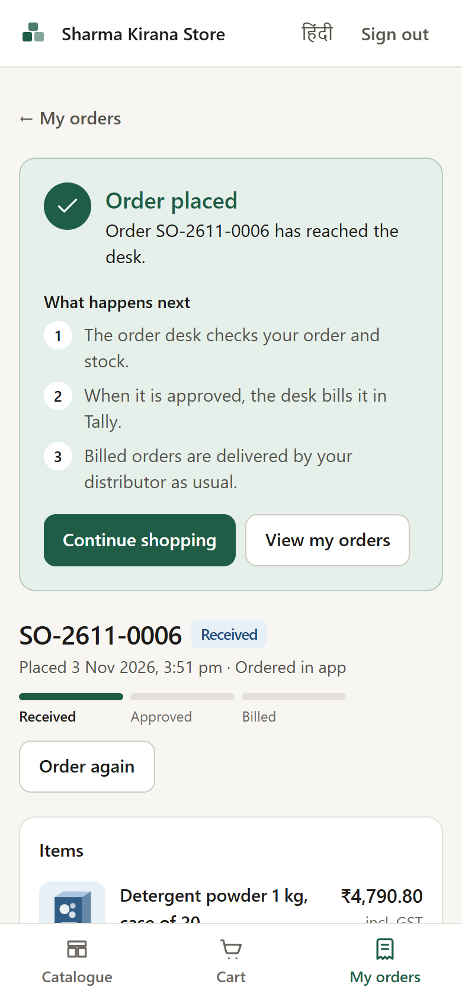

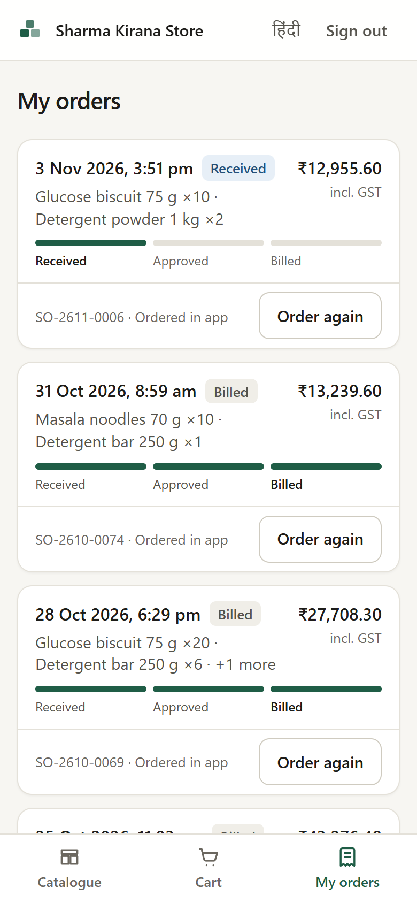
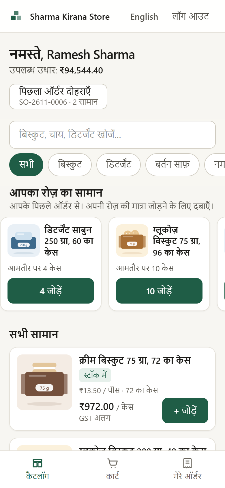
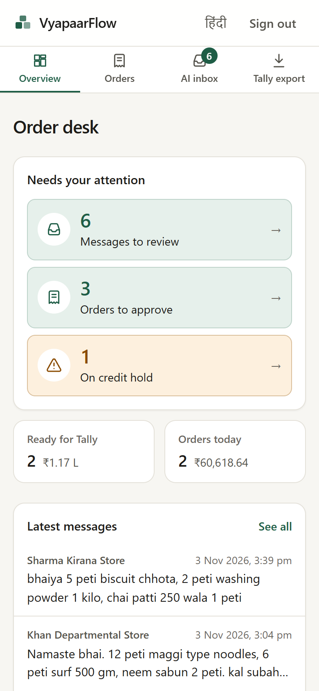

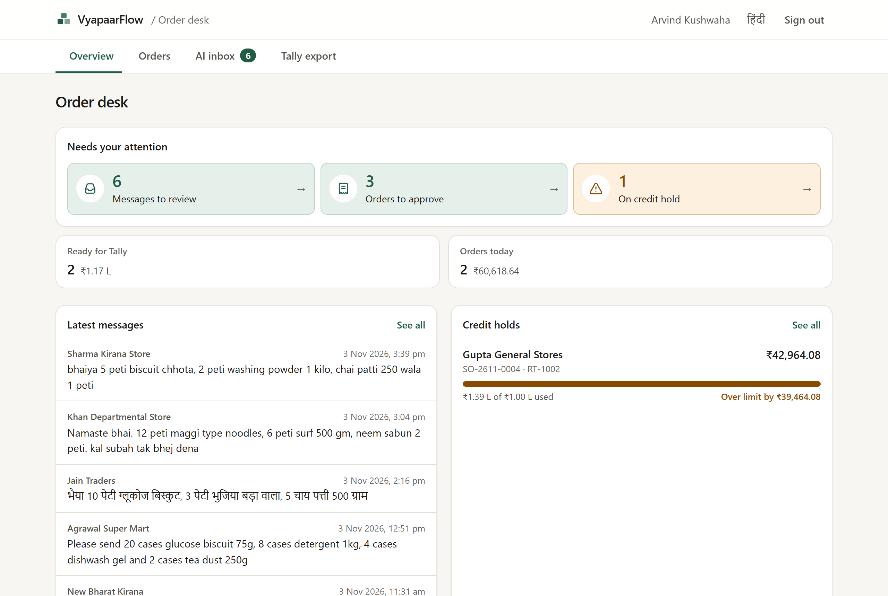

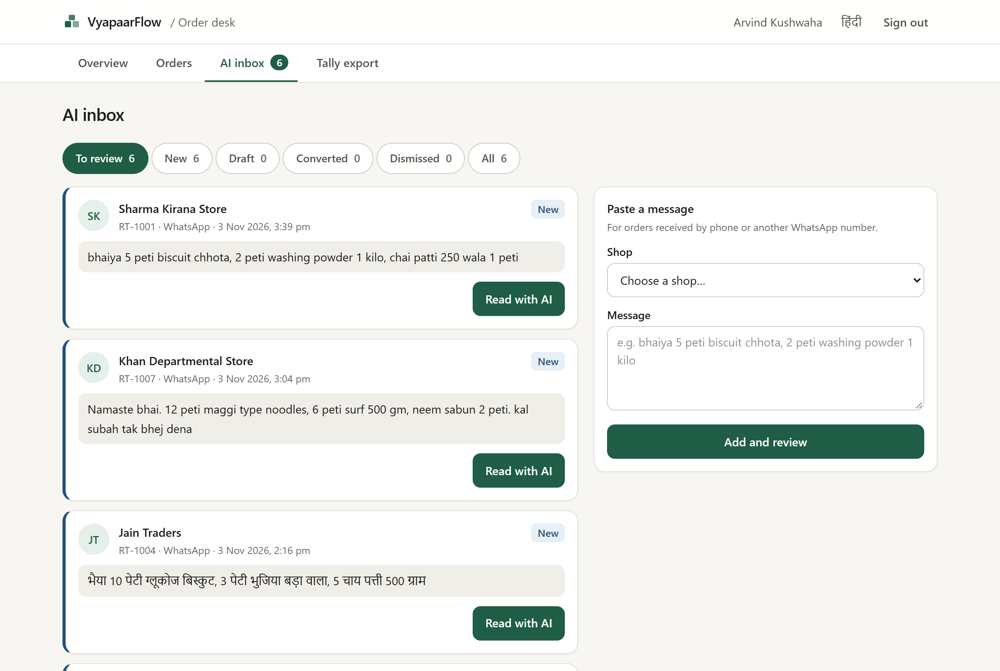

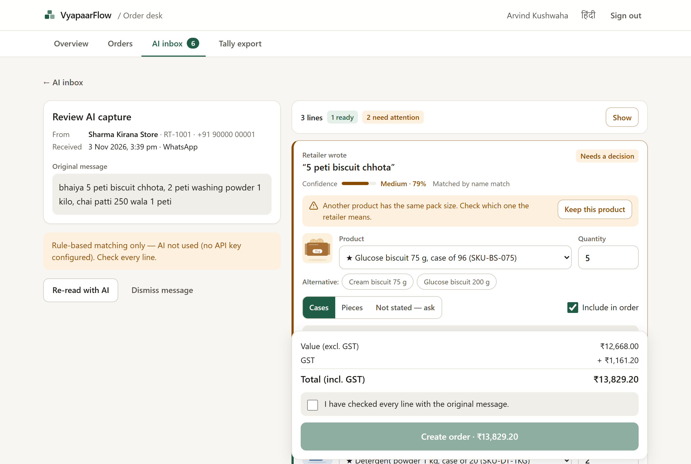

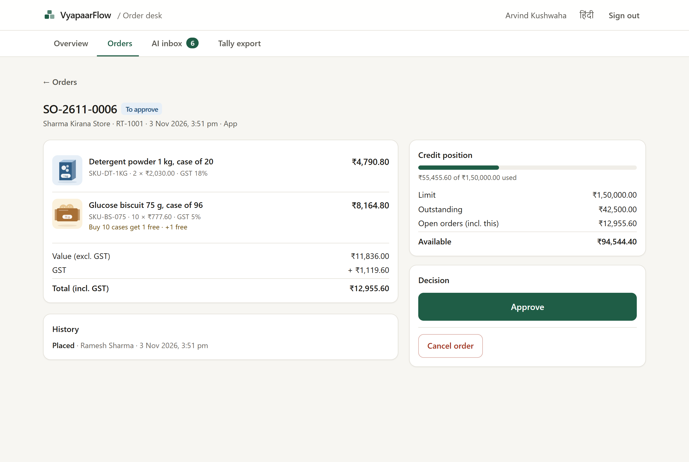

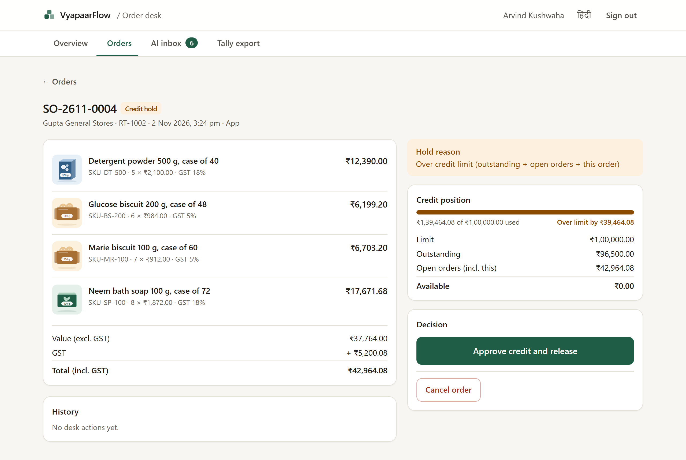

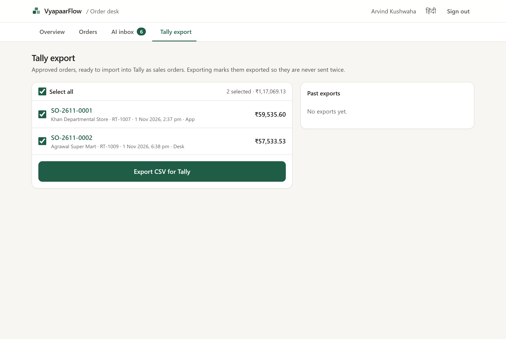

